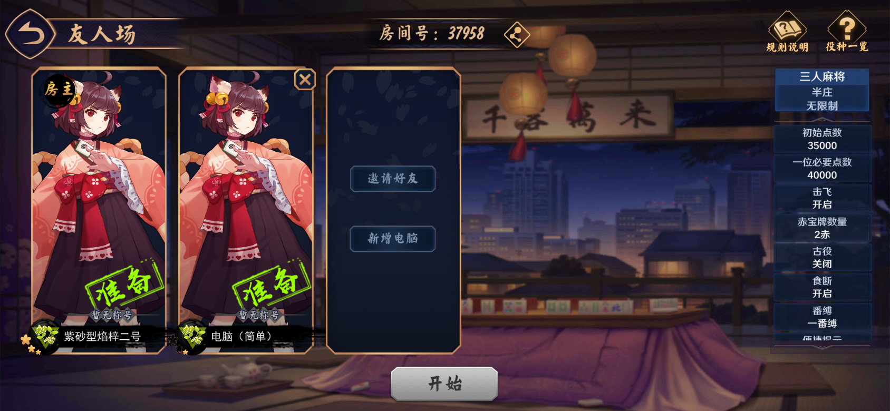

# 云间日麻

## Unity 0.6.16 · 原生装扮特效与结算修正（2026-10-28）

包含 13 款和牌、11 款立直原生特效，保留 K.O.、猫过留痕、雪球方向和问心之镰竖直下劈修正。装扮列表支持框内滚动；手部只提供默认手部与橘猫手，默认手随角色性别切换。点数结算与终局显示各玩家本局装备的头像框，荣和／自摸时查看听牌不再被轮询关闭。切到后台等待 120 秒再托管。

[下载 APK](https://github.com/Rtyu3221cc/YunJianRiiChi/releases/download/unity-0.6.16/yunjian-riichi-unity-0.6.16.apk) · [发布页](https://github.com/Rtyu3221cc/YunJianRiiChi/releases/tag/unity-0.6.16) · [对话交接与下一批特效方案](docs/handoff-unity-0.6.16.md) · [本轮实际界面截图](dist/previews/2026-10-28-wardrobe-r15/index.html)

versionCode 64，保留原包名、证书及 ARM64／ARMv7。181 项 Node 测试、11 项 Python 测试、571 项 Unity 单元断言和 58 项本轮界面／交互检查通过。完整包验证见同版 verification.json；历史 R13 特效专项结果与本次新跑的检查分别记录。Android 真机安装、触控、音效、后台服务、多手机局域网及峰值内存仍需实测。新特效有原始资源和动画可继续还原，无法预览的条目先按资源完整性验收，不宣称已与原版视觉核对。

## Unity 0.6.13 · 装扮与牌桌特效（2026-10-26）

宿舍加入装扮选择、原资源图标与模型／特效预览，提供 11 类、28 件内置装扮，每类至少两件可切换。装扮包括手部、立直棒、鸣牌指示、立直／和牌特效、音乐、头像框、桌布、牌背、牌面及大厅背景。房间按玩家同步装扮，并在整场对局中保持选择。

修正气泡鸣牌指示的朝向，并加入普通引导和众星捧月；鸣牌指示跟随可响应的弃牌。烈焰、爆炎龙卷与冰霜使用原始粒子层级和材质参数；默认立直棒恢复普通白棒红点。装扮暂由安装包内置，多套预设、预设重命名和装扮资源按需下载尚未实现。

[下载 APK](https://github.com/Rtyu3221cc/YunJianRiiChi/releases/download/unity-0.6.13/yunjian-riichi-unity-0.6.13.apk) · [发布页](https://github.com/Rtyu3221cc/YunJianRiiChi/releases/tag/unity-0.6.13) · [交接与验证](docs/handoff-unity-0.6.13.md) · [装扮界面预览](dist/previews/2026-10-25-wardrobe-r3/index.html) · [四视角特效预览](dist/previews/2026-10-25-wardrobe-r5/index.html)

versionCode 61，沿用原包名和签名证书，支持 ARM64／ARMv7。验证结果见发布附件 `unity-0.6.13-verification.json`；编辑器自动检查与手机安装、触摸、声音及多手机局域网实测分别记录。

## Unity 0.6.7 · 全角色资源目录（2026-10-21）

当前固定目录开放 **122 名角色、486 套服饰（69 套动态）**。一姬、二阶堂美树仍完整内置；其余角色按需下载，宿舍保留轻量头像。部分下载集合维持女性 TOP10＋汪次郎，全部下载提供当前目录中的其余角色。旧资源地址保留，新增／变更包使用独立版本。安装校验结束后释放临时资源，立绘和语音按需缓存；角色排序支持多行滚动。

[下载 APK](https://github.com/Rtyu3221cc/YunJianRiiChi/releases/download/unity-0.6.7/yunjian-riichi-unity-0.6.7.apk) · [程序发布页](https://github.com/Rtyu3221cc/YunJianRiiChi/releases/tag/unity-0.6.7) · [全部角色资源](https://github.com/Rtyu3221cc/YunJianRiiChi/releases/tag/character-resources-v2) · [新增角色／皮肤维护说明](docs/character-resource-maintenance.md) · [交接文档](docs/handoff-unity-0.6.7.md) · [实际资源截图](dist/previews/unity-0.6.7-resources/index.html)

versionCode 55，保留原包名、证书与双架构。详细测试结果、资源加载检查和签名摘要见本版 `verification.json`。包括本轮资源窗口排版、四行列表和定位描边修正；新增角色与皮肤需要更新 APK，当前尚未实现远程目录热更新。Android 真机安装、触摸、声音、低内存及多手机热点尚未实测。

## Unity 0.6.6 · 角色资源按需下载（2026-10-20）

女性TOP10＋汪次郎，共11名角色、71套服饰（17套动态），现已提供完整角色资源包；另保留未来与寺崎千穗理，共13名可用角色、79套服饰。一姬、二阶堂美树仍内置且不可删除，其余可从宿舍或设定的“资源”页下载、管理和删除。首次进入可选全部／推荐／暂不下载，推荐集合额外资源约231 MB。未知角色仅显示轻量头像和遮罩，不会误加入出战、星标或随机池。

房间支持GitHub下载、局域网接收／房主中转，或在本机以一姬替代；冻结随机结果并等待所有真人确认资源后开局。下载支持校验、取消和续传，删除会同步清理角色偏好。

[下载 APK](https://github.com/Rtyu3221cc/YunJianRiiChi/releases/download/unity-0.6.6/yunjian-riichi-unity-0.6.6.apk) · [程序发布页](https://github.com/Rtyu3221cc/YunJianRiiChi/releases/tag/unity-0.6.6) · [角色资源](https://github.com/Rtyu3221cc/YunJianRiiChi/releases/tag/character-resources-v1) · [交接文档](docs/handoff-unity-0.6.6.md) · [实际效果图](dist/previews/2026-10-20-character-resources/index.html)

versionCode54，保留原包名、证书与双架构。146项Node单元、561项既有Unity断言、2561项完整角色资源断言和26个双平台bundle内容检查通过；详细验证以同版verification.json为准。Android真机安装、触摸、声音、多手机热点和后台下载尚未实测。

## Unity 0.6.5 · 雀士界面与随机配置修正（2026-10-19）

重做切换雀士与指定/随机配置，修正页签间距、展开框连接和底部留白、九宫格拼接缝、滑块留边及数字位置。随机模式开关独立于候选，支持星标过滤并保留已选服饰。同步修正拜访滚动、宿舍竖排姓名、动态/静态立绘尺寸、服饰介绍滚动与大厅立绘的还原、保存和隐藏控件。

[下载 APK](https://github.com/Rtyu3221cc/YunJianRiiChi/releases/download/unity-0.6.5/yunjian-riichi-unity-0.6.5.apk) · [发布页](https://github.com/Rtyu3221cc/YunJianRiiChi/releases/tag/unity-0.6.5) · [交接与验证](docs/handoff-unity-0.6.5.md) · [最新效果图](dist/previews/2026-10-19-character-system-r6/index.html)

versionCode 53，原包名、原证书、ARM64+ARMv7。单元、运行回归及最终APK验证见本版验证记录；Android真机安装、触摸、声音和多手机热点联机尚未实测。

## Unity 0.6.4 · 四雀士角色系统（2026-10-19）

加入未来、一姬、二阶堂美树、寺崎千穗理，共 21 套服饰、626 段原版语音和 71 张聊天表情。宿舍支持角色档案、服饰介绍、立绘鉴赏、星标与拖动排序；两套动态皮肤支持原始骨骼动画与静态立绘切换。大厅可保存每套皮肤的位置和大小，并设置出战角色或随机角色池；随机选择在整场对局开始时确定，小局、轮询和重连期间保持一致。其他玩家可看到并听到对应角色。

[下载 APK](https://github.com/Rtyu3221cc/YunJianRiiChi/releases/download/unity-0.6.4/yunjian-riichi-unity-0.6.4.apk) · [发布页](https://github.com/Rtyu3221cc/YunJianRiiChi/releases/tag/unity-0.6.4) · [交接与验证](docs/handoff-unity-0.6.4.md) · [最新效果图与视频](dist/previews/2026-10-19-character-system-r2/index.html)

versionCode 52，沿用原包名、原证书、ARM64 与 ARMv7。所有角色好感设为五星，服饰与表情全部解锁；语音灯笼功能和筛选暂不开放。非牌桌页面加入樱花飘落。服饰卡片、开场与动作提示器使用原版场景构图参数及旧皮肤裁切规则。出战切换面板和牌桌其他已知布局问题留待后续修正；Android 真机安装、触摸、音频及多手机热点测试仍待确认。

## Unity 0.6.3 · 原版动作提示器与牌面居中（2026-10-18）

修正牌桌花色偏右偏下、掉线闪电位置，以及四个方位的立直／吃／碰／杠／拔北提示。保留原版字图完整画布与斜边遮罩；按每个字的可见高度统一字号，双字提示自然增加宽度。

[下载 APK](https://github.com/Rtyu3221cc/YunJianRiiChi/releases/download/unity-0.6.3/yunjian-riichi-unity-0.6.3.apk) · [发布页](https://github.com/Rtyu3221cc/YunJianRiiChi/releases/tag/unity-0.6.3) · [更换对话交接](docs/handoff-unity-0.6.3.md) · [实际运行预览](dist/previews/2026-10-18-table-review-character-size/index.html)

versionCode 51，保留原包名、原证书及双架构。本次也提交此前 0.6.0–0.6.2 尚未发布的役种资料、设置、播放列表、教程修正和首次立直火焰效果。测试、签名及包完整性见 [验证记录](dist/验证记录-unity-0.6.3.md)。Android 真机安装、触摸、声音及多手机热点联机待验证。

## Unity 0.6.2 · 立直牌特效与教程翻页修正（2026-10-18）

恢复新手教程的上下翻页箭头，音乐信息组再下移 1px。加入原版火焰立直粒子和对应音效：本局每位玩家第一次打出立直牌时播放，重复轮询和恢复快照不重播，新一局重新允许；特效跟随打牌手中的牌并在牌河落点收尾。

[本地 APK](dist/yunjian-riichi-unity-0.6.2.apk) · [0.6.2 交接](docs/handoff-unity-0.6.2.md)

versionCode 50，原包名和原证书，支持覆盖安装。32 项针对性检查通过；手机实测待用户确认。未发布 GitHub。

## Unity 0.6.1 · 遮罩与界面修正试用版（2026-10-17）

规则说明的全屏遮罩使用原素材中部区域，去掉上下透明像素与浅色边缘；音乐信息的图标、文字和曲名整体再上移 1px。包含第五轮预览中的图解首帧闪现修正、规则页签取消缩放、创建房间上移淡入、全屏遮罩、侧栏位置和音乐默认全选／随机。

[本地 APK](dist/yunjian-riichi-unity-0.6.1.apk) · [0.6.1 交接](docs/handoff-unity-0.6.1.md)

versionCode 49，沿用原包名与证书，可覆盖安装。未发布 GitHub，手机实测待用户确认。

## Unity 0.6.0 · 役种资料与声音／画面设置试用版（2026-10-17）

接入原版素材的役种一览、新手教程、点数与符数图解，以及声音／画面设置。大厅和对局曲目支持多选、试听、循环／随机和 2 秒交叉淡化；异形屏适配实际移动大厅两侧控件。移除预览里误加的触摸指示圆圈，修正帧率下拉框、曲目栏文字和役种侧栏位置。

[本地 APK](dist/yunjian-riichi-unity-0.6.0.apk) · [0.6.0 交接](docs/handoff-unity-0.6.0.md)

versionCode 48，沿用原包名和签名，供覆盖安装试用。未发布 GitHub；真机触摸、声音与多手机局域网需在手机上检查。

## Unity 0.5.46 · 默认透明底金色二维码（2026-10-17）

修正 0.5.45 将金色二维码保留为备选的问题：准备房间分享／邀请和牌桌星形入口现默认显示透明底金色二维码，保留大尺寸与反色识别支持。

[下载 APK](https://github.com/Rtyu3221cc/YunJianRiiChi/releases/download/unity-0.5.46/yunjian-riichi-unity-0.5.46.apk) · [发布页](https://github.com/Rtyu3221cc/YunJianRiiChi/releases/tag/unity-0.5.46) · [最新交接 Markdown](docs/handoff-unity-0.5.46.md)

versionCode 47，沿用原证书。本次按用户要求直接提交及打包，未运行测试；0.5.45 的测试记录仅为历史基线。真机扫码未验证。

## Unity 0.5.45 · 二维码、役满与 AI 接管（2026-10-17）

加入相机／相册扫码、放大的邀请二维码及反色识别；原版役满机会／确定、拔剑音效和秋季《金秋送爽》；整庄模式、听牌点击开关、两分接管、离线遮罩、全 AI 保持终局。修正对家立直牌深度、响应提示时序、右侧四按钮间距及结算声音：数字变化滴声，第一位当一次，终局无音效。

[下载 APK](https://github.com/Rtyu3221cc/YunJianRiiChi/releases/download/unity-0.5.45/yunjian-riichi-unity-0.5.45.apk) · [发布页](https://github.com/Rtyu3221cc/YunJianRiiChi/releases/tag/unity-0.5.45) · [新对话交接 Markdown](docs/handoff-unity-0.5.45.md) · [预览](dist/previews/unity-0.5.45/index.html) · [验证记录](dist/验证记录-unity-0.5.45.md)

源码包含完整 Unity、Android 服务、离线引擎、资源和测试；APK 通过 Release 分发。Node 129 项、Unity 单元 62 项及完整 Play／大厅／房间回归通过。versionCode 46，原证书，双架构；签名及完整性通过。Android 真机安装、触摸、相机／相册扫码、声音及多手机局域网尚未实测。

## Unity 0.5.43 · 自摸牌与确认倒计时（2026-10-16）

修复自摸演出期间的临时牌位重叠：牌和手部动作对齐预留落点，沿原位垂直起落，保留模型尺寸与静止布局。点数转移与排名演出完成后，暗色按钮显示“确认(3)”并在 3 秒后自动确认，可提前点击；“确认”与“返回大厅”统一为 31 号字；终局“下一局”仍倒计时 9 秒。

包含全员托管等待本机完整结算、双响与粒子完整播放、换局清理及 AI 随机 700–1000ms 等待的修复。

[下载 APK](https://github.com/Rtyu3221cc/YunJianRiiChi/releases/download/unity-0.5.43/yunjian-riichi-unity-0.5.43.apk) · [发布页](https://github.com/Rtyu3221cc/YunJianRiiChi/releases/tag/unity-0.5.43) · [实际 Unity 录制](dist/ai-settlement-review-0.5.43/index.html) · [修改说明](docs/自摸与结算倒计时-0.5.43.md)

验证：122 项规则／房间测试，984 项 Unity 自摸与倒计时专项断言；完整回归及 APK 校验见发布记录。没有连接 Android 真机，安装、触摸、音频及多人热点未实测。


## Unity 0.5.42：终局、回座与 AI 托管

[下载 0.5.42 APK](https://github.com/Rtyu3221cc/YunJianRiiChi/releases/download/unity-0.5.42/yunjian-riichi-unity-0.5.42.apk)，versionCode 43，包名 com.yunjian.riichi.unity，沿用原证书。

优化大厅人物与三个场次招牌的入退场方向、创建页遮罩与图文对齐；细化终局暗遮罩、排名、铜币／PT、自家标识和底部按钮。统一“食断”尺寸的中弹窗及原版动画，取消／离开左侧深色、确认／继续右侧黄色；修复按钮黑色接缝和 AI 托管文字底托拉伸，回座提示采用三行排版。

终局“下一局(9)”逐秒减至 0 自动确认，保留房间设置和玩家；三个场次与“牌局”灯笼共用原连接回座，不再输入恢复码。房主主动退出结束整桌，客人主动退出由电脑接替；意外断线保留回座资格。支持手动托管、180 秒操作超时及离线托管，返回后可收回操作；同局域网按房号加入，也可接替真正电脑位。既有核心牌理、计分和 AI 决策算法保持原样。

118 项 Node 测试、1100 项 Unity 大厅断言通过；另完成既有完整 Play 牌桌回归，后者不计入精确断言数量。最终 APK 的离线资源、双架构、ZIP 完整性、v1／v2、API 23 独立 v1、原证书及 16 KB 对齐均需通过发布核验。真机安装、触摸、Android 后台 Service 与多手机局域网尚未验证；没有房主迁移机制。

[本版界面与三段动画](dist/session-ui-0.5.42/index.html) · [验证记录](dist/验证记录-unity-0.5.42.md) · [机器可读结果](dist/unity-0.5.42-verification.json) · [校验和](dist/SHA256-unity-0.5.42.txt) · [新对话交接 HTML](docs/handoff-unity-0.5.42.html)。安装包及源码／发布 ZIP 由 [GitHub Release](https://github.com/Rtyu3221cc/YunJianRiiChi/releases/tag/unity-0.5.42) 分发；Unity APK 不加入源码 Git／LFS。

## Unity 0.5.41：大厅与准备房间

[下载 0.5.41 APK](https://github.com/Rtyu3221cc/YunJianRiiChi/releases/download/unity-0.5.41/yunjian-riichi-unity-0.5.41.apk)，versionCode 42，沿用原证书。

重构大厅、创建／加入房间和准备房间管理；按参考优化原版素材、字体、卡片、姓名组件、数字键盘、规则说明和弹窗。高级设置保留当前引擎的实际默认规则。牌桌打牌代码保持 0.5.39 基线。

8 项房间管理测试、246 项 Unity 大厅检查及 APK 签名／完整性检查通过。本次未进入对局、未运行牌桌回归；真机安装、触摸和多手机热点未验证。[修改与验证记录](docs/0.5.41大厅与准备房间.md) · [11 张界面截图](dist/unity-0.5.41-lobby.html) · [校验和](dist/SHA256-unity-0.5.41.txt)。



## Unity 0.5.39：其他玩家手牌避让副露

[下载0.5.39 APK](https://github.com/Rtyu3221cc/YunJianRiiChi/releases/download/unity-0.5.39/yunjian-riichi-unity-0.5.39.apk)，versionCode 40，沿用原证书。

其他玩家的站立手牌、和牌摊牌和流局摊牌按副露可见边缘避让，自摸牌随摊牌平移；保留统一牌尺寸、副露贴靠与用户确认的较大间距。[修改与回滚说明](docs/0.5.39其他玩家手牌避让与回滚.md) · [17张前后对照与回归截图](dist/unity-0.5.39-screenshots.html) · [0.5.38回滚APK](https://github.com/Rtyu3221cc/YunJianRiiChi/releases/download/unity-0.5.39/yunjian-riichi-unity-0.5.38-rollback-v40.apk)。安卓真机未测。

## Unity 0.5.38：副露贴靠

[下载0.5.38 APK](https://github.com/Rtyu3221cc/YunJianRiiChi/releases/download/unity-0.5.38/yunjian-riichi-unity-0.5.38.apk)，versionCode 39，沿用原证书。

同一副露组内和组间按可见牌边缘贴靠，保留0.5.37的尺寸、透视和区域对齐。[修改与回滚说明](docs/0.5.38副露贴靠.md) · [19张前后对照](dist/unity-0.5.38-screenshots.html) · [0.5.37回滚APK](https://github.com/Rtyu3221cc/YunJianRiiChi/releases/download/unity-0.5.38/yunjian-riichi-unity-0.5.37-rollback-v39.apk)。安卓真机未测。

## Unity 0.5.37：桌面牌尺寸统一试验

[下载0.5.37试验APK](https://github.com/Rtyu3221cc/YunJianRiiChi/releases/download/unity-0.5.37/yunjian-riichi-unity-0.5.37.apk)，versionCode 38，沿用原证书。

桌面牌共用原模型尺寸和透视相机，动画牌继承落地目标尺寸；移除副露与拔北独立缩放，保留区域锚点及操作手牌大小。[改动、验证和回滚说明](docs/0.5.37牌桌尺寸统一试验与回滚.md) · [38张前后截图](dist/unity-0.5.37-screenshots.html) · [0.5.36回滚APK](https://github.com/Rtyu3221cc/YunJianRiiChi/releases/download/unity-0.5.37/yunjian-riichi-unity-0.5.36-rollback-v38.apk)。回滚包保留0.5.36程序内容，versionCode同为38。安卓真机未测。

## Unity 0.5.36：立直横置标记顺延

[下载 Unity 0.5.36 APK](https://github.com/Rtyu3221cc/YunJianRiiChi/releases/download/unity-0.5.36/yunjian-riichi-unity-0.5.36.apk)，versionCode 37，沿用原证书。

立直宣言牌被吃碰杠拿走后，下一张弃牌横置；再次被拿走时继续顺延，后续普通牌恢复通常方向。显示标记与真实立直宣言分开，不重复扣分或放棒。[修改说明与截图](docs/0.5.36立直横置标记顺延.md)。安卓真机未测。

## Unity 0.5.35：提示、手牌衔接与AI思考

[下载 Unity 0.5.35 APK](https://github.com/Rtyu3221cc/YunJianRiiChi/releases/download/unity-0.5.35/yunjian-riichi-unity-0.5.35.apk)，versionCode 36，沿用原证书。

修正长按听牌、对家自摸手牌衔接、胜负缩小、原版荣和／自摸提示、北牌紧邻与放置时序、流局摊牌大小／位置；加入AI随机500～800ms思考及原版All Last，移除对局等待响应文字。[逐项修改与截图](docs/0.5.35逐项修正.md) · [第10项尺寸分析](docs/牌桌尺寸计算分析-0.5.35.md)。安卓真机未测。

## Unity 0.5.34：立直摸牌时序与供托说明

[下载 Unity 0.5.34 APK](https://github.com/Rtyu3221cc/YunJianRiiChi/releases/download/unity-0.5.34/yunjian-riichi-unity-0.5.34.apk)，versionCode 35，沿用原证书。

立直手牌等上一家动作与自家摸牌展示完成后再置灰，可打的四条保持正常色；结算新增和牌分数／供托来源说明，12000和牌＋1000立直供托合计13000，点炮者只付12000。[实现与截图](docs/0.5.34立直摸牌时序与供托说明.md) · [截图确认包](https://github.com/Rtyu3221cc/YunJianRiiChi/releases/download/unity-0.5.34/yunjian-riichi-unity-0.5.34-screenshots.zip)。安卓真机未测。

## Unity 0.5.33：手牌中轴与副露位置

[下载重新核验的 Unity 0.5.33 APK](https://github.com/Rtyu3221cc/YunJianRiiChi/releases/download/unity-0.5.33/yunjian-riichi-unity-0.5.33-signed.apk)，versionCode 34，沿用原证书。完整文件73,408,552字节；[签名与下载复核](docs/0.5.33安装包签名与下载复核.md)。

自家副露在0.5.32基础上再下移8像素，保持放大后的尺寸；修正手机左右安全边距不对称时手牌偏离牌桌中轴，保留实际遮挡时的避让。[实现与实际截图](docs/0.5.33手牌中轴与副露位置.md) · [截图确认包](https://github.com/Rtyu3221cc/YunJianRiiChi/releases/download/unity-0.5.33/yunjian-riichi-unity-0.5.33-screenshots.zip)。安卓真机未测。

## Unity 0.5.32：和牌交接与原版音效

[下载 Unity 0.5.32 APK](https://github.com/Rtyu3221cc/YunJianRiiChi/releases/download/unity-0.5.32/yunjian-riichi-unity-0.5.32.apk)，versionCode 33，沿用原证书。

修正荣和／自摸站立手牌与摊牌重叠；从雀魂 APK 提取和牌横幅 `cutin` 与开局名牌 `winlose` 原版音效，并接入一次性播放；自家副露下移7像素，尺寸保持。[实现与来源](docs/0.5.32和牌交接与原版音效.md) · [截图和音效试听包](https://github.com/Rtyu3221cc/YunJianRiiChi/releases/download/unity-0.5.32/yunjian-riichi-unity-0.5.32-screenshots.zip)。安卓真机未测。

## Unity 0.5.31：自家副露尺寸与称号间距

[下载 Unity 0.5.31 APK](https://github.com/Rtyu3221cc/YunJianRiiChi/releases/download/unity-0.5.31/yunjian-riichi-unity-0.5.31.apk)，versionCode 32，沿用原证书。

重新按雀魂原图校准自家副露的实际轮廓：可见宽度较0.5.30增大约28%，手牌大小保持不变；开局称号向用户名下移约10像素。[副露前后与原图对照](dist/previews/unity-0.5.31-meld-comparison.png) · [称号对照](dist/previews/unity-0.5.31-title-comparison.png) · [修正说明](docs/0.5.31副露尺寸与称号间距.md)。81项规则／协议及专项实际渲染检查通过；安卓真机未测。

## Unity 0.5.30：1012-3 逐项修正

安卓包：[下载 Unity 0.5.30 APK](https://github.com/Rtyu3221cc/YunJianRiiChi/releases/download/unity-0.5.30/yunjian-riichi-unity-0.5.30.apk)，versionCode 31，v1＋v2 签名并沿用此前证书。

修正积分后名次依次出现、负号、开局段位／称号／姓名、立直提示和手部同步、立直棒放置时序、四向自摸牌位置及朝向、立直后可杠／拔北及新摸牌颜色、等待确认文字和自家副露布局；接入 APK 原版胡牌横幅转场与一姬立绘。视频中的九万反光符合三麻一万／九万互相指示的规则，已提供两种局面的核对截图。

[11项说明与截图](docs/1012-3逐项修正与截图.md) · [41张截图及离线确认页](https://github.com/Rtyu3221cc/YunJianRiiChi/releases/download/unity-0.5.30/yunjian-riichi-unity-0.5.30-screenshots.zip) · [截图总览](dist/previews/unity-0.5.30-review-overview.jpg)。81 项规则／协议测试、完整 Unity Play 与专项渲染检查通过；安卓真机未测。

## Unity 0.5.29：点击樱花与牌桌复核

安卓包：[下载 Unity 0.5.29 APK](https://github.com/Rtyu3221cc/YunJianRiiChi/releases/download/unity-0.5.29/yunjian-riichi-unity-0.5.29.apk)，versionCode 30，v1+v2 签名，与 0.5.27／0.5.28 同证书，可覆盖更新。SHA-256 见 `dist/SHA256-unity-0.5.29.txt`。

- 点击屏幕任意位置播放雀魂默认点击特效 `effect_click_default`（樱花序列帧花瓣 + 粉色闪光，APK 原贴图，绘制在 HUD 之上）。
- 同类牌指示改为整张牌（牌面、牌身、描边）统一染原版蓝色，修正只有牌面变蓝的问题。
- 左上房间文字不再被裁切；牌河错落幅度调小约 30%。
- 拔北牌按投影后的牌面大小缩小，不大于自家副露牌面；拔北动作中搬运的牌同步缩放。

[修正说明与验证](docs/1012-2牌桌光照与质感.md#0529-复核修正)。安卓真机未测。

## Unity 0.5.28：牌桌光照与质感（1012-2）

本地安卓包：`dist/yunjian-riichi-unity-0.5.28.apk`，versionCode 29，v1+v2 签名，与 0.5.27 同证书，可覆盖更新。

- 麻将牌改用 APK `scene_mj` 方向光与 `Catfood/Cartoon_nonoutline` 卡通明暗（从编译后 GLES3 程序移植）：牌面全亮、朝向玩家的侧面 .81，牌身按原 `mjp_mid` 混合牌背与牌面图集；描边改用原 shader 实际输出的 `_Tint`。
- 每张牌下加入原版 `effect_shadow` 软阴影；牌桌加入原版 `room/sun_shine` 光束与浮尘粒子（完整序列化模块）。
- 左上房间文字加入原 `bg_type` 底图；玩家名称按原 `container_name` 尺寸缩小，“暂无称号”改用官方 `notitle` 图片；吃碰杠胡拔北按钮按原 `UI_ChiPengHu` 位置居中偏右；牌河错落加大；桌布亮度按参考图校准。
- 宝牌栏和小麻将预览不再在 `OnGUI` 中渲染，修正加入粒子后宝牌栏显示为青色的问题。

[实现、来源与验证](docs/1012-2牌桌光照与质感.md)。安卓真机未测。

## Unity 0.5.27：恢复自家副露尺寸

安卓包：[下载 Unity 0.5.27 签名兼容修正版 APK](https://github.com/Rtyu3221cc/YunJianRiiChi/releases/download/unity-0.5.27/yunjian-riichi-unity-0.5.27-signed.apk)，versionCode 28。

针对“解析失败：安装包没有签名文件”的提示，补齐 v1/JAR 签名并保留 v2，签名证书保持一致。请重新下载 `-signed.apk` 文件；[签名修正与验证](docs/0.5.27安装包签名修正.md)。

包含下述 0.5.25／0.5.26 的特效、牌桌与终局修正，并取消自家副露贴底时采用的缩小目标，恢复此前牌的显示宽度，保留右下角位置及手牌间距。实际 Unity Play 已检查三种分辨率、1～4 组副露的尺寸、底边和遮挡，并复查吃／杠动画。见[修正记录](docs/自家副露尺寸修正.md)；安卓真机未测。

## Unity 0.5.26：1012 牌桌样式与显示修正

本地安卓包：`dist/yunjian-riichi-unity-0.5.26.apk`，versionCode 27。

- 姓名使用原版底图／字体，房间采用“铜之间 · 三／四人东／南”；原菱形感叹号按听牌条件出现，移除左侧出牌提示。
- 自家副露贴齐底边并与手牌分开；对家立直搬运牌对齐实际牌河目标。
- 指示牌按自身是否为宝牌决定反光，整体反光降低 15%；改善斜视牌河的纹理采样，加入稳定的小幅错落。
- 终局头像与字图缩小，恢复固定绿色 `+0.0`、金币和 PT 的 `+0`。

[实现和验证范围](docs/1012牌桌样式与显示修正.md)。81 项规则／协议测试与 Unity 专项验证通过；安卓真机和热点联机未测。

## Unity 0.5.25：1011 参考优化

本地安卓包：`dist/yunjian-riichi-unity-0.5.25.apk`，versionCode 26，与 0.5.24 同签名。

- 宝牌指示、红五及实际宝牌循环反光；完整杠牌组交接，加杠保留原碰。
- 按 APK 四个独立锚点修正拔北位置；采用 12 个原版计分箭头变换。
- 积分变化后播放排名字图提示，整场结束提供三／四人终局排名页。
- 直接导入 APK 的役满六层粒子和吃碰两层粒子完整序列化模块，保留原贴图、网格、材质和来源记录。

[修改与解包范围](docs/1011优化与解包范围.md)。本次不能称为完整恢复原工程：相关 Lua 仍加密，Shader 保留编译后资源；界面流程、UV 播放和交接代码是当前客户端适配。81 项规则／协议测试及 Unity 专项验证通过，安卓真机和热点联机未验证。

## Unity 0.5.24 原版背景、役满火焰与整局开场

安卓包：[下载 Unity 0.5.24 APK](https://github.com/Rtyu3221cc/YunJianRiiChi/releases/download/unity-0.5.24/yunjian-riichi-unity-0.5.24.apk)，versionCode 25，同签名覆盖更新。

- 吃牌组小幅下移，保留左右间距和牌底到金边的留白；四字结算标题沿用原字号。
- 累计役满及一至六倍役满加入原版六层火焰/火星，使用原网格、4×4帧图、颜色曲线和横向发射范围，在标题出现300ms后启动。
- 结算改用原版 `bg_jiesuan` 与1433×781的 `bg_jiesuan1` 分层，按原预制体矩形等比缩放/裁切，保留花纹和斜边比例。
- 新开一整局播放原版四向画框、一姬立绘、玩家姓名、自家标签、胜负字与花瓣和声音；进出使用400ms的strongIn曲线。之后再发牌、理牌，AI等待开场结束。
- 开场按整局编号去重。下一小局、轮询和已看过的重连不重播；结束整局后新开下一整局会再播放，支持三人和四人。

[开场预览](dist/previews/unity-0.5.24-intro.png)、[役满火焰预览](dist/previews/unity-0.5.24-fire.png)、[不同屏幕比例](dist/previews/unity-0.5.24-backgrounds.png)、[吃牌框](dist/previews/unity-0.5.24-chi.png)、[实现与素材出处](docs/原版背景与整局开场.md)、[验证记录](dist/验证记录-unity-0.5.24.txt)。

## Unity 0.5.23 动画顺序与结算布局

安卓包：[下载 Unity 0.5.23 APK](https://github.com/Rtyu3221cc/YunJianRiiChi/releases/download/unity-0.5.23/yunjian-riichi-unity-0.5.23.apk)，versionCode 24，同签名覆盖更新。

- 拔北统一放在每个座位的左角，牌的朝向随座位旋转；对手和牌时保留自己的手牌。
- 出牌、鸣牌、立直与下一次摸牌依次呈现，吃碰胡、拔北等操作等前面的动作和理牌结束后开放。
- 放倒手牌加入预备、加速、触桌和回弹阶段；自摸/荣和提示文字恢复较大的尺寸，火龙卷朝向当前相机。
- 结算背景覆盖屏幕边缘；满贯标题避开点数，三倍役满等四字标题保持字号并左移。展示普通和牌、满贯各等级和一至六倍役满。
- 听牌框去掉横线；吃牌小麻将保留左右间距，上移后给底边留出空隙。

[各等级实际 Unity 预览](dist/previews/unity-0.5.23-limits.png)、[桌面预览](dist/previews/unity-0.5.23-review.png)、[实现说明](docs/动画顺序与结算布局.md)、[验证记录](dist/验证记录-unity-0.5.23.txt)。

## Unity 0.5.22 原版提示、结算报役与火龙卷

安卓包：[下载 Unity 0.5.22 APK](https://github.com/Rtyu3221cc/YunJianRiiChi/releases/download/unity-0.5.22/yunjian-riichi-unity-0.5.22.apk)，versionCode 23，同签名覆盖更新。

- 荒牌流局标题按牌桌投影轴居中，待牌在自己的框内居中；放倒手牌播放原版 `showtile` 音效，轮询不重播。
- 听牌与吃牌组合采用原版深蓝金边花纹框。听牌逐牌显示未见张数，吃牌组合只显示小麻将；长按查看和出牌前预览沿用现有操作。
- 结算使用一姬逐条念出役种，按原始顺序和语音时长展示；番符、点数、满贯标题带对应声音，满贯/跳满、倍满/三倍满、役满采用三组原版鼓声。支持一至六倍役满语音。
- 胡牌特效使用《荣牌特效.mp4》对应的「火龙卷」305034，九层原版粒子、真实旋风/环形网格、帧动画贴图和碎石，配套音轨与录像波形相关度 0.991。移除旧的简化旋风绘制。
- 非自己回合也可以抬起选牌，并在轮询和新摸牌后保持选中的牌；自己的回合仍通过再次点击提交合法出牌。

[实现与资源出处](docs/原版提示与结算音效.md)、[提示框预览](dist/previews/unity-0.5.22-indicators.png)、[火龙卷逐帧预览](dist/previews/unity-0.5.22-tornado.png)、[验证记录](dist/验证记录-unity-0.5.22.txt)。

## Unity 0.5.21 开局理牌与对局音频

安卓包：[下载 Unity 0.5.21 APK](https://github.com/Rtyu3221cc/YunJianRiiChi/releases/download/unity-0.5.21/yunjian-riichi-unity-0.5.21.apk)，versionCode 22，同签名覆盖更新。

- 开局按照实际发牌顺序，每 0.3 秒展示一组四张牌，200ms 淡入下落；1.2 秒后横向滑动整理，最后保留庄家摸牌间隔。动画期间不接受手牌出牌，非庄家的首次摸牌也不会打断整理。
- 加入录像同款雀魂对局 BGM，与角色语音独立循环播放；正常状态轮询保持播放位置。返回大厅停止，切后台暂停、回前台续播。
- 发牌、出牌、副露、立直棒和自摸落牌使用雀魂原始桌面音效；落牌声音与手部动画交接时刻同步，每次动作只播放一次。
- 声音设置分别控制角色语音、BGM、桌面音效的开关和音量，并可试听荣和与落牌。音乐采用流式加载；全部音频随 APK 离线打包。
- 实际 Unity 的理牌节拍、淡入、最终牌位、轮询不重播、延迟重连、落牌声音时机、独立静音以及后台暂停/续播验证通过；规则和公共协议 76/76 通过。安卓真机未执行。

[动画与音频说明](docs/开局动画与对局音频.md)、[理牌逐帧预览](dist/previews/unity-0.5.21-opening.png)、[验证记录](dist/验证记录-unity-0.5.21.txt)。

## Unity 0.5.20 听牌预览与长按查看

安卓包：[下载 Unity 0.5.20 APK](https://github.com/Rtyu3221cc/YunJianRiiChi/releases/download/unity-0.5.20/yunjian-riichi-unity-0.5.20.apk)，versionCode 21，同签名覆盖更新。

- 选中准备打出的牌，只有打出这张牌后可以听牌才自动显示对应待牌；换选不能听牌的牌时收起。
- 右侧「听牌提示」改为长按查看当前待牌，松开或移出按钮后收起。短按不会切换常驻开关；已听牌且未选牌时也不再常驻显示。
- 长按期间允许只读查看，不受正常状态轮询的忙碌标志影响；拖出按钮后在手牌上松开会消耗该手势，避免误出牌。切换后台或进入结算会清理长按状态。
- 实际 Unity 自动预览、短按、长按、松开、拖出和失去焦点验证通过，完整 Play 与 APK 双架构/v2 原签名/16KB 对齐/离线资源校验通过。安卓真机未执行。

实际预览：[选牌听牌预览](dist/previews/unity-0.5.20-indicator-open-1688.png)、[平时收起](dist/previews/unity-0.5.20-indicator-wait-idle-844.png)、[长按查看](dist/previews/unity-0.5.20-indicator-thirteen-844.png)。[验证记录](dist/验证记录-unity-0.5.20.txt)。

## Unity 0.5.19 结算名称居中修正

安卓包：[下载 Unity 0.5.19 APK](https://github.com/Rtyu3221cc/YunJianRiiChi/releases/download/unity-0.5.19/yunjian-riichi-unity-0.5.19.apk)，versionCode 20，同签名覆盖更新。

- 结算玩家名称上移 12.5 个基准画布单位，居中于斜名牌的可见框内，修正文字贴近下边框的问题。旋转中心随文字框同步移动，保持原版约 4.748 度倾角。
- 实际 Unity 774×438、934×430 两种参考比例核对名称上下留白，完整 Play 回归、APK 双架构/v2 原签名/16KB 对齐/离线资源校验通过。安卓真机未执行。

实际预览：[774×438 结算](dist/previews/unity-0.5.19-result-reference-774.png)、[934×430 结算](dist/previews/unity-0.5.19-result-reference-934.png)。[验证记录](dist/验证记录-unity-0.5.19.txt)。

## Unity 0.5.18 结算名称倾角与牌列分组

安卓包：[下载 Unity 0.5.18 APK](https://github.com/Rtyu3221cc/YunJianRiiChi/releases/download/unity-0.5.18/yunjian-riichi-unity-0.5.18.apk)，versionCode 19，同签名覆盖更新。

- 玩家名称采用 APK UI_Win 原版约 4.748 度倾角，与名牌背景同向；使用局部矩阵保留各宽高比下的倾角和位置。
- 结算牌列严格按「手牌 → 大间隔 → 全部副露 → 大间隔 → 和牌」。多组副露连续排列，不在每组副露或每张牌之间添加间隔；无副露时只保留和牌前的间隔。
- 单牌显示框直接填满各牌位，保持实战麻将纹理/牌背的 0.62 比例，消除旧版缩窄框和留白导致的组内细缝；完整牌列统一适配屏幕。
- 实际 Unity 结算截图覆盖无副露、两组副露、暗杠及两种参考比例；完整 Unity Play 回归、APK 双架构/v2 原签名/16KB 对齐/离线资源校验通过。安卓真机未执行。

实际预览：[两组副露结算](dist/previews/unity-0.5.18-result-reference-774.png)、[宽屏结算](dist/previews/unity-0.5.18-result-reference-934.png)、[暗杠结算](dist/previews/unity-0.5.18-result-kan-1688.png)。[验证记录](dist/验证记录-unity-0.5.18.txt)。

## Unity 0.5.17 手牌大小与结算布局修正

安卓包：[下载 Unity 0.5.17 APK](https://github.com/Rtyu3221cc/YunJianRiiChi/releases/download/unity-0.5.17/yunjian-riichi-unity-0.5.17.apk)，versionCode 18，同签名覆盖更新。

- 恢复原版手牌相机/牌模型的固定高度，约占画面高度 14.1%；不再为副露同时缩小整排手牌。先保留左右空间，空间不足时在桌面上移开会遮挡的副露，保持其模型大小和朝向。
- 按雀魂 APK 的 UI_Win 预制体坐标重排结算牌列、宝牌/里宝牌、役种、番符和点数；一姬立绘保持。少量役种按原版先纵向排列，多役种采用两列。
- 宽屏结算背景铺满，内容继续按中心锚点等比缩放；放大满贯/跳满/多倍役满标题，修正牌列过于靠右、番符和点数过低及宽屏两侧留空。
- 完整 Unity Play 回归通过，精确 934×430 和 774×438 参考比例及原有四种分辨率截图核对；APK 双架构、v2 原签名、16KB 对齐及离线素材一致性通过。安卓真机触控/热点联机未执行。

实际 Unity 合成场景预览：[手牌与副露](dist/previews/unity-0.5.17-matching-tiles-1688.png)、[宽屏结算](dist/previews/unity-0.5.17-result-reference-934.png)、[普通比例役满结算](dist/previews/unity-0.5.17-result-reference-774.png)。[对照说明](docs/手牌与结算布局对照.md)，[验证记录](dist/验证记录-unity-0.5.17.txt)。

## Unity 0.5.16 同类牌全模型蓝色与副露避让

安卓包：[下载 Unity 0.5.16 APK](https://github.com/Rtyu3221cc/YunJianRiiChi/releases/download/unity-0.5.16/yunjian-riichi-unity-0.5.16.apk)，versionCode 17，同签名覆盖更新。

- 核对原版客户端 `ViewPai.OnChoosedPai` 和 `setMeshColor`：采用原版 `(0.615, 0.827, 0.976, 1)`，给同类明牌的整个麻将模型染蓝，包括牌面、牌身侧边、底部和轮廓；修正 0.5.15 只改牌面的遗漏。
- 自己手牌中的相同牌保持原样；暗牌和暗杠背面不参与，赤五/普通五匹配及选牌抬起保持。
- 手牌布局避开桌边所有座位的可见副露和拔北，修正左侧玩家副露被前景手牌遮住；按屏幕投影留出空隙，适配已有四种测试分辨率。
- 完整 Unity Play 画面/玩法回归通过。APK 双架构、v2 原签名、16KB 对齐及离线素材一致性通过；安卓真机触控/热点联机未执行。

预览：[全模型蓝色与左侧副露](dist/previews/unity-0.5.16-matching-tiles-1688.png)。[原版代码对照](docs/同类牌高亮原版对照.md)，[验证记录](dist/验证记录-unity-0.5.16.txt)。

## Unity 0.5.15 同类明牌蓝色覆盖

安卓包：[下载 Unity 0.5.15 APK](https://github.com/Rtyu3221cc/YunJianRiiChi/releases/download/unity-0.5.15/yunjian-riichi-unity-0.5.15.apk)，versionCode 16，同签名覆盖更新。

- 按参考图将同类明牌改为淡蓝色牌面覆盖，取消黄色边框和地面光圈，牌壳、红色牌背和牌面图案保持原素材。
- 自己手牌中的相同牌保持原色，选中牌只按既有操作抬起，不附加同类特效。
- 只匹配当前公开的牌面，包括牌河、副露、拔北和已翻开的宝牌；对手暗牌、暗杠牌背不参与，赤五与普通五仍一起匹配。
- 完整 Unity Play 回归、原牌面比例/像素一致性、状态刷新和出牌交接检查通过。安卓双架构、v2 同签名、16KB 对齐通过，真机触控/热点联机未执行。

预览：[蓝色同类明牌与原色手牌](dist/previews/unity-0.5.15-matching-tiles-1688.png)。详见 [验证记录](dist/验证记录-unity-0.5.15.txt)。

## Unity 0.5.14 明牌高亮、出牌时序与九种九牌

安卓包：[下载 Unity 0.5.14 APK](https://github.com/Rtyu3221cc/YunJianRiiChi/releases/download/unity-0.5.14/yunjian-riichi-unity-0.5.14.apk)，versionCode 15，同包名同签名覆盖更新。

- 点选待出的手牌后，标出当前可见的同类牌，赤五与普通五一起匹配；覆盖自己的明牌、牌河、副露、拔北和已翻开的宝牌，排除对手暗牌、被吃碰走的舍牌与暗杠牌背。
- 收到出牌状态时立即隐藏尚未落下的新牌，再由手部动画交接到牌河，修复先出现、消失、又出现的问题。公开事件携带一基河牌序号，连续/同种出牌各自排队，轮询不会提前亮出等待落牌的对象。
- 和牌详情整页下移 28 个基准像素，牌、立绘、宝牌、役种和点数一起移动；确认按钮仍可操作。
- 自摸手部动画的牌从抬手到拍下全程正面朝上，取消牌背到正面的翻转。
- 九种九牌先显示安装包原字图，再展开声明者的公开手牌，保留其他玩家的牌背；确认后进入点数页，连庄和确认流程继续由房主决定。
- 74 项规则、AI、公共协议测试通过。完整 Unity Play 回归、公开牌隐私/同帧出牌队列/各座位自摸朝向、原资源 APK 检查通过。安卓真机触控与热点联机未执行。

预览：[同类明牌](dist/previews/unity-0.5.14-matching-tiles-1688.png)、[九种九牌](dist/previews/unity-0.5.14-nine-3-1688.png)、[和牌结算下移](dist/previews/unity-0.5.14-result-hand-1688.png)。详见 [验证记录](dist/验证记录-unity-0.5.14.txt)。

## Unity 0.5.13 结算原素材、吃牌框与胡牌火焰

安卓包：[下载 Unity 0.5.13 APK](https://github.com/Rtyu3221cc/YunJianRiiChi/releases/download/unity-0.5.13/yunjian-riichi-unity-0.5.13.apk)，versionCode 14，同包名同签名覆盖更新。

- 吃牌组合的小麻将放进花饰框内，保留框线、完整花饰和上下留白。
- 和牌结算使用原 UI_Win 的 pg_he / pg_zimo 字图，修正宝牌行位置和“满贯”等档位文字大小；麻将继续复用当前对局的真实牌面和牌背。
- 点数结算使用 APK 原局标题书法字体、增减分数字字体、1–4 位字图、升降箭头、转分弯箭头和蓝色确认按钮。头像移到右上方，排名位于左下方、分数位于右下方，保留暗下去的牌桌 HUD。
- 对照《荣牌特效.mp4》，把细光带改成更高、更宽且有填充的火焰柱，调整旋转火焰带、亮黄核心和碎石。火焰细节贴图来自 APK；旋转柱几何及时间动画在 Unity 中按录像重新适配，并非该皮肤完整特效预制体的逐字移植。
- 四分辨率完整 Unity 回归、三/四麻各座位的荣和/自摸、四个火焰时间点、原牌面像素一致性、APK 双架构/v2 签名/16KB 对齐通过。安卓真机触控及热点联机未执行。

预览：[吃牌](dist/previews/unity-0.5.13-indicator-chi-1688.png)、[和牌结算](dist/previews/unity-0.5.13-result-hand-1688.png)、[点数结算](dist/previews/unity-0.5.13-result-scores-1688.png)、[转分过程](dist/previews/unity-0.5.13-result-transfer-1688.png)、[胡牌火焰](dist/previews/unity-0.5.13-win-4-tsumo-flame-0.45.png)。详见 [验证记录](dist/验证记录-unity-0.5.13.txt)。

## Unity 0.5.12 吃牌、听牌、振听与荒牌流局

安卓包：[下载 Unity 0.5.12 APK](https://github.com/Rtyu3221cc/YunJianRiiChi/releases/download/unity-0.5.12/yunjian-riichi-unity-0.5.12.apk)，versionCode 13，同包名同签名覆盖更新。

- 吃牌响应时直接显示各个小麻将组合，点击组合完成吃牌。小麻将复用对局的牌面、赤牌颜色、玫瑰红牌框和原花饰框。
- 手牌上方增加听牌提示；选中弃牌后预览该牌打出后的待牌。显示原版橙色“无役”，区分有役荣和与门清自摸/立直增加的役；支持十三面待牌及提示开关。
- 振听时在手牌左侧显示原版竖排红底白字标识，接入舍牌振听、同巡振听和立直后永久振听。待牌信息只来自自己的手牌与公开牌局。
- 荒牌流局保留牌桌与头像，先翻倒各家的手牌，公开听牌家的牌面，未听牌家继续盖牌。原版“荒牌流局”“听牌／未听牌”和待牌展示，确认后进入点数转移与排名，最后确认准备下一局。
- 对照用户四张截图及《荒牌流局.mp4》，继续沿用当前牌面/牌背和一姬相关动作素材。72 项规则/协议测试、三/四麻每种听牌人数、四分辨率界面与完整 Unity 回归、Android 双架构打包/v2 签名/16KB 对齐通过。安卓真机触控及热点联机未执行。

预览：[吃牌组合](dist/previews/unity-0.5.12-indicator-chi-1688.png)、[听牌与无役](dist/previews/unity-0.5.12-indicator-open-1688.png)、[振听标识](dist/previews/unity-0.5.12-indicator-furiten-844.png)、[荒牌流局](dist/previews/unity-0.5.12-draw-4-reveal-1688.png)。详见 [验证记录](dist/验证记录-unity-0.5.12.txt) 与 [ARTWORK.md](ARTWORK.md)。

## Unity 0.5.11 结算麻将牌修正

安卓包：[下载 Unity 0.5.11 APK](https://github.com/Rtyu3221cc/YunJianRiiChi/releases/download/unity-0.5.11/yunjian-riichi-unity-0.5.11.apk)，versionCode 12，同包名同签名覆盖更新。

- 结算手牌复用对局的原牌面图集、红色边框与 shader，保持对局手牌宽高比 0.62；移除旧裁切图片被 Unity 导入缩放后拉窄的问题。
- 宝牌/里宝牌复用对局 HUD 的三维牌渲染，包括未翻开的玫瑰红牌背；暗杠两端也使用原手牌背面图集，替换纯色占位块。
- 对照用户视频和 APK `UI_Win` 原控件的 80×120 牌槽、6°倾角以及宝牌相对手牌的缩放，保持完整和牌与独立胡牌间距。继续使用对局的牌面/牌背和一姬立绘。
- 实际对局手牌网格与结算纹理逐像素对照、宽高轮廓、红色花色、暗杠/五张宝牌及四分辨率结算检查通过。65 项规则/协议测试、Android 双架构打包、v2 签名和 16KB 对齐通过；安卓真机触控及热点联机未执行。

预览：[修正后的结算](dist/previews/unity-0.5.11-result-hand-1688.png)、[暗杠及全部宝牌](dist/previews/unity-0.5.11-result-kan-1688.png)。详见 [验证记录](dist/验证记录-unity-0.5.11.txt) 与 [ARTWORK.md](ARTWORK.md)。

## Unity 0.5.10 录像对照优化

最新安卓包：[下载 Unity 0.5.10 APK](https://github.com/Rtyu3221cc/YunJianRiiChi/releases/download/unity-0.5.10/yunjian-riichi-unity-0.5.10.apk)，versionCode 11，同包名同签名，可覆盖更新。

- 按用户《荣牌特效.mp4》调整橙黄色火焰旋涡、环绕碎石与火星；自摸先落背面牌，再翻到正面并播放特效。各方赢家摊开公开手牌，一姬立绘沿用原角色。
- 原结算背景、役种笔刷、番符圆盘与点数箭头从用户 APK 导入；番数、符数、得点和满贯系列标题直接调用原金色/白色数字与笔刷字图。先展示完整和牌、宝牌/里宝牌、逐项役种、番符与得点，再播放各座位点数转移、名次变化。双响依次结算两名赢家；确认、下一局、终局重开沿用房间流程。
- 立直不可出的牌仅降低 RGB 亮度，保留红色、绿色和原有透明度。
- 65/65 规则和协议测试通过；Unity 实际 Play 覆盖三/四麻各方向、翻面交接、轮询/重连、双响、四分辨率结算和保色 shader；双架构 APK 检查通过。安卓真机触控和热点联机待实测。

预览：[火焰胡牌特效](dist/previews/unity-0.5.10-win-3-tsumo-effect-0.png)、[手牌和役种结算](dist/previews/unity-0.5.10-result-hand-1688.png)、[点数和排名结算](dist/previews/unity-0.5.10-result-scores-1688.png)。来源与适配范围见 [ARTWORK.md](ARTWORK.md)，详见 [验证记录](dist/验证记录-unity-0.5.10.txt)。


## Unity 0.5.9 荣和、自摸与胡牌特效

最新安卓包：[下载 Unity 0.5.9 APK](https://github.com/Rtyu3221cc/YunJianRiiChi/releases/download/unity-0.5.9/yunjian-riichi-unity-0.5.9.apk)，versionCode 10，与此前 Unity 包同签名，可覆盖更新。

- 荣和、自摸显示雀魂原始喊字，继续使用吃碰的一姬立绘和语音。
- 自摸接入原 `Zimo_Anim-Zimo` 手部动作，携带实际胡牌并准确落牌；荣和在放铳牌上播放特效。
- 胡牌显示原默认七层光效，保留原贴图、颜色、寿命和透明度/尺寸曲线；抢杠与抢北使用被抢的牌作为目标，双响分别提示两名赢家。
- 牌桌播完提示、动作及胡牌特效后再显示结算；刷新不重播，重连跳过历史事件。

预览：[荣和提示](dist/previews/unity-0.5.9-win-3-ron-call-0.png)、[自摸提示与手部](dist/previews/unity-0.5.9-win-3-tsumo-call-0.png)、[胡牌特效](dist/previews/unity-0.5.9-win-3-tsumo-effect-0.png)。素材与 Unity 适配范围见 [ARTWORK.md](ARTWORK.md)，检查见 [0.5.9 验证记录](dist/验证记录-unity-0.5.9.txt)。安卓真机效果待实测。

## Unity 0.5.8 拔北动作与樱花花瓣

此版本安卓包：[下载 Unity 0.5.8 APK](https://github.com/Rtyu3221cc/YunJianRiiChi/releases/download/unity-0.5.8/yunjian-riichi-unity-0.5.8.apk)，versionCode 9，与此前 Unity 包同签名，可覆盖更新。

- 拔北显示原始“拔北”喊字，继续使用吃碰时的一姬立绘和语音。
- 手中带着北牌，沿用原 Fulu 手部动作，并将落牌关键帧对准本次拔出的北牌；已有北牌和副露保持可见。
- 北牌落下后，九片粉色樱花花瓣向上飘散、翻转并淡出。花瓣使用原安装包的 4×4 樱花贴图，发射节奏与位置适配当前牌桌。
- 公共拔北事件携带 `z4` 和拔北次序；轮询、重连不会重复播放，旧房主省略这些字段也能显示北牌动作。

预览：[拔北提示](dist/previews/unity-0.5.8-north-call-0.png)、[手部动作](dist/previews/unity-0.5.8-north-hand-0.png)、[落牌花瓣](dist/previews/unity-0.5.8-north-petals-0.png)。检查范围见 [0.5.8 验证记录](dist/验证记录-unity-0.5.8.txt)，素材来源见 [ARTWORK.md](ARTWORK.md)。安卓真机效果待实测。

## Unity 0.5.7 计分盘出牌指示灯

此版本安卓包：[下载 Unity 0.5.7 APK](https://github.com/Rtyu3221cc/YunJianRiiChi/releases/download/unity-0.5.7/yunjian-riichi-unity-0.5.7.apk)，versionCode 8，与原 Unity 包签名一致，可覆盖更新。

- 回合灯使用雀魂原始 `particle_shining` 短梯形纹理，保留高亮边缘和柔光；移除旧的代码生成常亮宽灯条。
- 按原两层粒子颜色、加色混合及 1 秒透明度曲线淡入、停留、淡出。原纹理和粒子配置适配现有 Unity 计分盘；坐标和尺寸换算见素材来源记录。
- 相同座位和局数的数据刷新保持闪烁相位，换回合重新开始，避免轮询导致动画反复重置。
- 验证覆盖四方向实际渲染、暗/亮/淡出截图及刷新连续性；原有三/四人布局、选牌和手部动作检查继续通过。安卓真机效果待实测。

预览见 [亮阶段截图](dist/previews/unity-0.5.7-turn-light-0-0.45.png)，完整检查见 [0.5.7 验证记录](dist/验证记录-unity-0.5.7.txt)，素材来源见 [ARTWORK.md](ARTWORK.md)。

## Unity 0.5.6 手部动画补全与操作修正

此版本安卓包：[下载 Unity 0.5.6 APK](https://github.com/Rtyu3221cc/YunJianRiiChi/releases/download/unity-0.5.6/yunjian-riichi-unity-0.5.6.apk)，versionCode 7，可覆盖此前 Unity 试玩版。

- 立直宣言牌改用原版 `Anim_Dapai_heng-LiQiPai` 横置动作：打出与立直喊字**同时**开始，宣言成立后接着由手部把立直棒放进计分盘槽位。表现层拆成手部与喊字两条通道，手部动作排队、喊字独立播放，不再互相推迟。
- 吃、碰、杠与三麻拔北接入原版 `Fulu_Ani-Fulu` 副露动作；落牌瞬间在副露锚点叠加原版 `bang` 加色撞击闪光，0.38 秒内扩散淡出。
- 按下立直按钮后，只有保持听牌的牌维持原亮度，其余置灰且不可点选；**不是自己选牌时不置灰**，手牌也不再变半透明。
- 回合灯移入计分盘点数槽下方的凹槽（盘面 y 210–222），立直棒放进其下方槽位（y 224–240），不再落在盘面之外。
- 雀魂手部动画全集只有打牌、立直出牌、自摸、副露、立直棒五个片段，**没有拔北专用动画**，拔北因此复用副露动作。
- 新增回归测试：立直出牌事件标记、响应选项归属、副露动作时长、立直棒交接时刻、手牌置灰。来源与 SHA-256 见 [ARTWORK.md](ARTWORK.md)。

## Unity 0.5.5 描边、响应光圈与副露避让

最新安卓包：[下载 Unity 0.5.5 APK](https://github.com/Rtyu3221cc/YunJianRiiChi/releases/download/unity-0.5.5/yunjian-riichi-unity-0.5.5.apk)，versionCode 6，可覆盖此前 Unity 试玩版。

- 响应牌复用原版 `majiangkuang` 发光纹理，在模型底部渲染随桌面透视变化的加色光圈，保留上方箭头。
- 桌面麻将和竖立暗牌接入原版 `maque_outline` 描边网格及 `mjp_outline` 颜色，增加细暗色轮廓。
- 吃碰后手牌向左移动，按实际投影为副露保留空间；多组副露时等比适配，避免遮挡或拉伸。
- 各家拔北牌朝向桌心，沿座位侧边依次排列。

运行截图见 `dist/previews/unity-0.5.5-*`；来源及适配边界见 [ARTWORK.md](ARTWORK.md) 与 [渲染对照](docs/麻将渲染对照.md)，检查结果见 [验证记录](dist/验证记录-unity-0.5.5.txt)。安卓真机触控与热点联机待实测。

## Unity 0.5.4 吃碰布局与动作

此版本安卓包：[下载 Unity 0.5.4 APK](https://github.com/Rtyu3221cc/YunJianRiiChi/releases/download/unity-0.5.4/yunjian-riichi-unity-0.5.4.apk)，versionCode 5，可覆盖此前 Unity 试玩版。

- 被吃、碰、杠取走的牌不再留在牌河中；保留规则引擎中的历史记录，显示按剩余牌重新排布。副露移到各家手牌外侧的角落，左右对手手牌外移，拔北牌独立摆放。
- 吃、碰、杠、荣和、自摸、立直、拔北与跳过使用原始提示图。响应牌有黄色边框和箭头，多种吃牌组合先展开牌面供选择。
- 四个方向使用原始手部模型、皮肤和出牌动画数据，碰等操作显示原始一姬角色切入与文字特效。修正模型面朝向，手掌、手腕和手臂采用不透明材质，避免局部穿透缺失。

预览见 `dist/previews/unity-0.5.4-*`；素材来源见 [ARTWORK.md](ARTWORK.md)，原始资源与适配边界见 [渲染对照](docs/麻将渲染对照.md)。动画和操作提示由当前工程的 C# 事件逻辑实现。验证记录见 [0.5.4 验证记录](dist/验证记录-unity-0.5.4.txt)；安卓真机触控与热点联机仍待实测。

## Unity 0.5.3 对手竖立手牌与计分盘

此版本安卓包：[下载 Unity 0.5.3 APK](https://github.com/Rtyu3221cc/YunJianRiiChi/releases/download/unity-0.5.3/yunjian-riichi-unity-0.5.3.apk)，versionCode 4，可覆盖 Unity 0.5.0–0.5.2。

对手手牌使用已有原始麻将网格竖立，牌背朝桌心、牌面朝所属玩家；暗杠、牌河仍按各自规则平放。计分盘完整保留原底图和字符图集，底图、点数、方位与黄色渐变回合灯共用坐标和座位旋转，放大点数字体并重新对齐槽位。

运行截图见 `dist/previews/unity-0.5.3-*`，计分盘近景见 [修改后截图](dist/previews/unity-0.5.3-score-hub.png)。四方点数已移入黑色区域，避免压到灰框。验证记录见 [0.5.3 验证记录](dist/验证记录-unity-0.5.3.txt)；安卓真机触控与热点联机待实测。

## Unity 0.5.2 原始麻将显示方式

此版本安卓包：[下载 Unity 0.5.2 APK](https://github.com/Rtyu3221cc/YunJianRiiChi/releases/download/unity-0.5.2/yunjian-riichi-unity-0.5.2.apk)。已检查用户提供的雀魂 APK，使用其中的桌面麻将网格及 UV；底部手牌采用原始手牌图集、牌背层和独立正交相机，替换估算比例的三维手牌。主相机沿用原预制体的 28 度视角及朝向，等比换算坐标单位。西瓜桌布、宝牌栏和头像边框保留。

预览见 dist/previews/unity-0.5.2-*，具体证据及适配边界见 docs/麻将渲染对照.md，验证记录见 dist/验证记录-unity-0.5.2.txt。未进行安卓真机验证。

## 0.5.0 更新

- 点击一张手牌选中，再次点击同一张牌打出；不要求在 450 毫秒内快速双击。点击另一张牌只切换选择，重复牌按实际位置选择。
- 立直宣言牌通过荣和响应窗口并交付 1000 点后，在该座位靠中央处显示立直棒；宣言牌被荣和不显示已交供托。横置牌按真实宽度占位，牌河仍按六张分行。
- 副露与拔北放大并移到手牌上方、桌面内侧；操作按钮也适当放大。
- 默认桌布和一姬的吃、碰、杠、立直、自摸、荣和、拔北配音来自雀魂官方公开资源；牌面、头像、计分盘和中文字体来自用户提供的 APK。资源均内置离线使用，来源及 SHA-256 见 [ARTWORK.md](ARTWORK.md) 和资源清单。
- 当前启用同一个角色的一姬配音，不混用此前的中文合成报牌。雀魂操作配音没有逐张报牌，普通出牌不再读牌名。
- 新增原生 Unity 三维客户端工程 [unity](unity/README.md)，复用手机房主、规则与 AI。已通过 Unity 6000.6.4f1 导入、C# 编译、Play 模式实际 AI 房间与两次点击出牌测试，并导出三麻/四麻三维布局截图；Android 构建及真机状态见交付验证记录。
- 此目录的 `dist/yunjian-riichi-0.5.0.apk` 仍是可直接安装的原有 Android/WebView 版本，已包含上述修复与素材，不是 Unity 构建。
- `dist/yunjian-riichi-unity-0.5.0.apk` 为已构建的 Unity 三维试玩版，采用独立包名 `com.yunjian.riichi.unity`，可与现有版本并存。Unity 编译、Play 模式和 APK v2 签名验证通过；真机安装、热点联机与后台行为尚未验证。

## 0.4.0 更新

- 自定义头像：大厅“头像 / 语音”或牌桌右上角“设置”中选择手机图片，居中裁切为 128×128 JPEG，预览后保存。同步给同桌玩家，刷新、续局和重新打开仍保留；可以恢复默认头像。仅发送压缩头像，不发送原图或图片元数据。
- Android 使用系统图片选择器，不申请整个相册的读取权限。头像与牌局分别保存在本机设置、房主存档中；更换头像只允许修改自己的座位。
- 内置 39 段中文语音：37 种牌名（含赤五）、荣和、自摸。真人与 AI 出牌都会报牌；和牌播报以规则引擎确认的结果为准。由本机中文合成语音预先生成 WAV，手机不需要网络或下载 TTS 语音包。
- 设置中可开关语音、调节音量、试听荣和；手机音量键控制媒体音量。进入牌桌不重播历史语音，重复轮询不重复播放，退到后台停止语音。
- 保留竖直侧边暗牌、双击出牌和无读秒机制。包名与签名不变，所有手机请统一升级到 0.4.0。

## 0.3.1 更新

- 左右暗牌改成竖直排列。
- 移除“打出”按钮；单击选牌，450 毫秒内连续点击同一张牌两次打出。点不同牌或间隔较长只改变选中。立直先点“立直”，再双击高亮手牌。

## 0.3.0 更新

- 横屏全屏牌桌：四边座位、绿色桌布、中央局数和余牌、底部手牌、右侧操作区。统一牌面比例与留白，素材随 APK 打包，离线使用。
- APK 内包含“单人练习 / 创建房间 / 加入房间 / 继续上次牌桌”。加入者输入房主局域网地址，原生网络桥接访问房间，无需跳转手机浏览器。
- 房主开局前可以添加、移除 AI，或一键补齐空位开局。支持 1 真人 + 2/3 AI，也支持多人混合 AI。
- AI 在房主端离线运行：向听数、有效进张、基础役种、立直、吃碰杠、拔北、和牌及简单防守。决策仅接收自己的脱敏玩家视图，不读取对手暗牌或未来牌山。这是基础启发式 AI，未训练强度模型，也没有难度档位。
- 真人操作不自动超时；AI 不会替掉线真人代打。AI 自动确认结算，真人确认后由房主进入下一局。
- 包名仍为 com.yunjian.riichi，versionCode 5，与 0.1.0 / 0.2.0 使用相同签名，可覆盖更新该包名版本。请勿先卸载，以免删除本机存档。

## 手机使用

1. 提前把 dist/yunjian-riichi-0.5.0.apk 复制到每台安卓手机安装。最低 Android 8.0；请提前更新 Android System WebView。所有界面、资源和规则均内置。
2. 一个人玩：打开“单人练习”，选择三麻/四麻、东风/半庄和赤宝牌，开始后自动补齐 AI。
3. 与朋友玩：房主开启系统个人热点，其他手机连接；出现“无互联网”时选择保持连接。房主在 App 中“创建房间”。
4. 房主点击“邀请好友”，告诉朋友显示的 http://手机地址:8765 和六位房间码；127.0.0.1 只用于本机，不要提供给朋友。
5. 朋友打开自己的 App，选择“加入房间”，输入房主地址（可只输入 IPv4，例如 192.168.43.1）、昵称和房间码；不要各自创建另一张牌桌。
6. 房主可在空位点“添加 AI”，也可移除 AI 留给朋友。准备好后点“补齐 AI 并开局”或“开始对局”。
7. 横屏点击选牌，再次点击同一张牌打出。立直先点“立直”，再选中并再次点击高亮手牌。吃碰杠 / 荣和需选择对应操作或“过”，真人不自动超时。
8. 结算时每位真人点“确认结算”，房主点“下一局”；AI 会自动确认。返回大厅保留牌局，点击“继续上次牌桌”可回座。
9. 在房间信息中保存个人恢复码。热点地址变化后重新“加入房间”，填写房间码和个人恢复码，可回到原座位。

0.3.0 按用户截图调整牌桌布局：四边暗牌、靠近中央的牌河、环绕计分盘的四家点数、左上宝牌与本场、底部手牌及独立操作区。绿色桌布保持不变，无真人读秒机制。修复相同手牌同时升起、选牌导致牌桌偏移及副露遮挡按钮的问题。牌面与两张头像来自用户提供的雀魂 APK，详见 [图像资源来源](ARTWORK.md)。

## 上飞机前一定做一次这样的演练

在地面用你们将携带的手机测试：关闭移动数据和外网 → 开飞行模式 → 按手机系统允许的方式打开 Wi-Fi / 热点 → 两至三位朋友连接 → 创建房间并实际打几巡 → 客户端刷新重连 → 房主退出 App 再打开检查续局。

**不同安卓机型对“飞行模式下开启热点”支持不同，本程序无法绕过系统限制。** 如果手机在飞行模式下不允许开热点，或该热点禁止客户端访问房主，必须在出发前解决组网问题；单靠 APK 不能保证飞机上能连起来。飞行中无线设备的使用以航司要求为准。

## 重连与排障

- 房主保持 App 前台亮屏。App 会申请前台服务和 CPU 唤醒锁，仍不能保证被系统强制停止后继续服务。系统返回键菜单中的“保存并退出”会停止服务但保留存档；重新打开可续局。
- 自动保存每次已接受操作；断线不会自动弃牌、出牌或跳过和牌机会。有人掉线时等待其回来。
- 同一 App、同一地址可点“继续上次牌桌”。热点 IP 变化、换设备或清理数据后，用六位房间码 + 自己的恢复码恢复原座位，昵称可随便填一个非空值。
- 连接不上：检查同一热点、地址端口 `8765`、`http://`、是否误开 VPN、手机是否自动切回其他 Wi-Fi。房主热点重开后重新查看地址。App 可能列出多个本地网卡地址，应使用热点网卡的地址。
- 提示“牌桌已更新”：另一个玩家刚提交操作，等待页面刷新，再选择一次。服务端拒绝过期请求，避免重复出牌。
- 如果丢失所有座位凭据，房主可从“房间”窗口结束牌桌，重新创建；这会清除该桌当前对局。
- 卸载 / 清除 App 数据会删除房主存档。清除浏览器数据会丢失该浏览器的座位凭据，请先保存恢复码。
- 使用带密码的自有热点。HTTP 只用于受信任的本地网络；无 TLS，不适合将端口映射到公网。

## 本版规则

日麻判型、向听、役种、符数和基本点使用 MIT 许可的 [@kobalab/majiang-core 1.4.1](https://github.com/kobalab/majiang-core)。联机、三麻、轮转和流局由本项目控制。不是 WRC、雀魂或天凤规则的逐条复制，以下是本桌明确采用的约定：

| 项目 | 本版约定 |
|---|---|
| 模式 | 3 人 / 4 人；东风 / 半庄；随机座次与起庄 |
| 初始点数 | 四麻 25000；三麻 35000 |
| 门清和役 | 食断、后付；一役起和，宝牌不能单独作役 |
| 常规计分 | 全套引擎支持役种、七对子、国士、符数、复合役满、双倍役满、数役满；大三元/大四喜包牌；无切上满贯 |
| 宝牌 | 赤五可选；里宝牌、杠宝牌、杠里；杠宝牌即时翻开 |
| 立直 | 1000 点、门清听牌、剩余活牌至少一轮；宣言牌被荣和不交供托；一发 / 两立直；立直后摸切，严格限制暗杠 |
| 振听 | 自家舍牌对全部听牌的永久振听；过和的同巡振听；立直过和后本局不可荣和 |
| 副露 | 吃、碰、明杠、暗杠、加杠；禁止食替；荣和优先，碰 / 杠优先于吃 |
| 抢杠 | 可抢加杠；暗杠只能被国士抢；抢杠前不增加新杠宝牌 |
| 多人和牌 | 双响；供托给离放铳者最近的赢家；各赢家分别计算本场；三家和流局 |
| 特殊流局 | 九种九牌、四风连打、四家立直、四杠散了；四杠由同一人开则不流局；流局满贯 |
| 荒牌流局 | 四麻听牌罚符总额 3000；三麻 2000；仅听牌者公开手牌；供托保留 |
| 三麻牌组 | 去掉二至八万，无吃牌；一万指示九万为宝牌，九万指示一万 |
| 三麻拔北 | 可保留北在手中；拔北加一宝牌，若北为表 / 里宝牌则额外计；不破门清，取消一发 / 首巡；从活牌山补牌，不算岭上；立直后只能拔摸来的北；仅国士可抢北 |
| 三麻支付 | 自摸损，去掉不存在的北家付款；荣和不折减；荣和每本场 300，自摸每付款人每本场 100 |
| 三麻流局差异 | 三风连打、三家立直不流局 |
| 连庄和终局 | 和牌 / 听牌连庄；特殊流局连庄；负分结束；末局目标四麻 30000 / 三麻 40000；达到目标且庄家为并列第一可和了 / 听牌止；不足目标最多延长一个场，最后一局允许连庄；遗留供托给首位 |
| 未做的内容 | AI 难度档位、观战、语音聊天、完整牌谱导出、房主迁移、顺位马 / 丘、错和罚符及可选地方役、自定义所有规则开关 |

玩法页在 APK 内，离线可查看。参考规则资料：[WRC 规则](https://www.worldriichi.org/s/WRC_Rules_2022_20220708_site.pdf)。有差异的地方以上表为准。

## 已执行的验证

- Android SDK Build Tools 35.0.0 + API 35 平台，Java 21 编译，最低 API 26 / 目标 API 32。
- APK v2 / v3 签名校验通过，无原生 ABI 依赖，可用于 ARM 与 x86 架构。
- Node 自动测试：鉴权、私牌隔离、过期请求、重复请求、存档回滚、恢复座位、立直供托、符数、无役、振听、多人荣和、吃碰优先、食替、抢杠、拔北、自摸损、特殊流局、终局等。
- 共 49 项 Node 测试通过，其中原有随机对局 24 局、新增 AI 混合对局 24 局，在每一步校验实体牌总数、每种牌数量、供托加总分守恒。
- 原生局域网地址校验：5 个合法地址通过，14 个非法目标被拒绝。
- 新增 7 项头像与语音测试：头像同步/权限/恢复、非法头像及存档失败回滚、出牌事件去重、荣和事件、静音、前后台及不同手机时钟。
- 新界面浏览器验证：单人 AI 四麻、添加/移除 AI、两个真人客户端配 AI 开局、选牌/确认出牌、重新加载回座；844×390 与 720×360 横屏布局检查。
- 0.4.0 浏览器验证：选择图片、128×128 压缩预览、保存并刷新恢复、静音持久化、出牌匹配对应 WAV、荣和试听；39 个 WAV 均可解码且非静音。
- **尚未验证**：Android 实机安装、原生 Service + WebView 的运行、真实热点多手机互联、飞行模式、后台 / 灭屏省电策略。浏览器模拟不等于手机实测。

## 源码和维护

主要入口：`app/src/main/java/com/yunjian/riichi/RoomService.java`（Android 服务、存档、HTTP）、`MainActivity.java`（全屏游戏与原生局域网请求桥接）、`app/src/main/assets/engine.js`（牌桌）、`client.js`（界面）、`ai.js`（离线 AI）、`voice.js`（离线语音事件播放）、`tests/`（规则与 AI 测试）。

浏览器页面只拿脱敏后的玩家视图；规则引擎页面与源文件不由局域网 HTTP 服务公开。玩法并不提供真钱或奖金功能。

开发者电脑运行：Node 22+（推荐 24），在项目目录执行：

```powershell
node scripts/bundle.cjs
node --test --test-isolation=none tests/*.test.cjs
node desktop.cjs
```

桌面测试服务器将打印本机房主入口。它与 APK 使用同一套规则，但不是安卓原生层测试。

重新打包（玩家无需操作）：准备 JDK 21，`JAVA_HOME` 指向该目录；本机现有 SDK 位于 `tools/sdk`。无 SDK 时：

```powershell
node scripts/download-tools.cjs
Expand-Archive tools/build-tools_r35_windows.zip tools/sdk -Force
Expand-Archive tools/platform-35_r02.zip tools/sdk -Force
pwsh -NoProfile -File build.ps1
```

工具下载来自 Google 官方仓库，按其仓库清单 SHA-1 校验。SDK 使用受其许可约束。没有改动系统级 Android SDK / Java 安装。首次签名密钥生成在 `build/local-signing.jks`，请保留以便覆盖安装更新；源码压缩包不包含此私钥。构建流程遵循 [Android D8](https://developer.android.com/tools/d8) 和 [apksigner](https://developer.android.com/tools/apksigner) 文档，先 zipalign 后签名。

`vendor/package` 保留第三方原版代码及 MIT 许可证。`scripts/bundle.cjs` 在生成的副本中仅追加“拔北宝牌”的计分输入，让它和普通宝牌一样在合法役存在后才生效。项目不需要在线 npm 安装。
