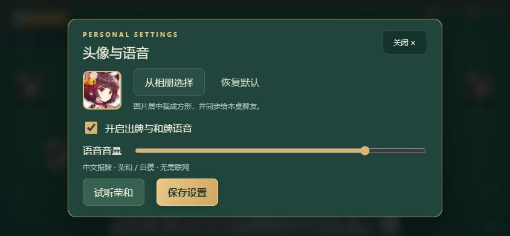

# 云间日麻 0.4.0

[下载 Android APK（0.4.0）](https://github.com/Rtyu3221cc/YunJianRiiChi/raw/refs/heads/main/dist/yunjian-riichi-0.4.0.apk) · [SHA-256 校验值](dist/SHA256.txt) · [验证记录](dist/验证记录-0.4.0.txt)

源码位于本仓库，安装包位于 dist。构建工具、签名私钥、运行存档及原始雀魂安装包不包含在仓库中。



安卓包名：`com.yunjian.riichi`。

安卓手机担任房主的三人 / 四人日麻小游戏。资源、规则引擎、存档和局域网服务器都放在 APK 里。房主和其他玩家都能直接在 APK 内开房、加入与打牌，单人也可添加 AI。游玩期间不需要电脑、账号、互联网、Node、Termux 或开发环境；浏览器加入仍保留兼容。

**交付状态：0.4.0 本地试玩版。已编译和验证 APK 签名、规则自动测试与桌面浏览器操作；尚未安装到安卓真机验证，不应把自动测试等同于所有机型可用或比赛级规则认证。**

## 0.4.0 更新

- 自定义头像：大厅“头像 / 语音”或牌桌右上角“设置”中选择手机图片，居中裁切为 128×128 JPEG，预览后保存。同步给同桌玩家，刷新、续局和重新打开仍保留；可以恢复默认头像。仅发送压缩头像，不发送原图或图片元数据。
- Android 使用系统图片选择器，不申请整个相册的读取权限。头像与牌局分别保存在本机设置、房主存档中；更换头像只允许修改自己的座位。
- 内置 39 段中文语音：37 种牌名（含赤五）、荣和、自摸。真人与 AI 出牌都会报牌；和牌播报以规则引擎确认的结果为准。由本机中文合成语音预先生成 WAV，手机不需要网络或下载 TTS 语音包。
- 设置中可开关语音、调节音量、试听荣和；手机音量键控制媒体音量。进入牌桌不重播历史语音，重复轮询不重复播放，退到后台停止语音。
- 保留竖直侧边暗牌、双击出牌和无读秒机制。包名与签名不变，所有手机请统一升级到 0.4.0。

## 0.3.1 更新

- 左右暗牌改成竖直排列。
- 移除“打出”按钮；单击选牌，450 毫秒内连续点击同一张牌两次打出。点不同牌或间隔较长只改变选中。立直先点“立直”，再双击高亮手牌。

## 0.3.0 更新

- 横屏全屏牌桌：四边座位、绿色桌布、中央局数和余牌、底部手牌、右侧操作区。统一牌面比例与留白，素材随 APK 打包，离线使用。
- APK 内包含“单人练习 / 创建房间 / 加入房间 / 继续上次牌桌”。加入者输入房主局域网地址，原生网络桥接访问房间，无需跳转手机浏览器。
- 房主开局前可以添加、移除 AI，或一键补齐空位开局。支持 1 真人 + 2/3 AI，也支持多人混合 AI。
- AI 在房主端离线运行：向听数、有效进张、基础役种、立直、吃碰杠、拔北、和牌及简单防守。决策仅接收自己的脱敏玩家视图，不读取对手暗牌或未来牌山。这是基础启发式 AI，未训练强度模型，也没有难度档位。
- 真人操作不自动超时；AI 不会替掉线真人代打。AI 自动确认结算，真人确认后由房主进入下一局。
- 包名仍为 com.yunjian.riichi，versionCode 5，与 0.1.0 / 0.2.0 使用相同签名，可覆盖更新该包名版本。请勿先卸载，以免删除本机存档。

## 手机使用

1. 提前把 dist/yunjian-riichi-0.4.0.apk 复制到每台安卓手机安装。最低 Android 8.0；请提前更新 Android System WebView。所有界面、资源和规则均内置。
2. 一个人玩：打开“单人练习”，选择三麻/四麻、东风/半庄和赤宝牌，开始后自动补齐 AI。
3. 与朋友玩：房主开启系统个人热点，其他手机连接；出现“无互联网”时选择保持连接。房主在 App 中“创建房间”。
4. 房主点击“邀请好友”，告诉朋友显示的 http://手机地址:8765 和六位房间码；127.0.0.1 只用于本机，不要提供给朋友。
5. 朋友打开自己的 App，选择“加入房间”，输入房主地址（可只输入 IPv4，例如 192.168.43.1）、昵称和房间码；不要各自创建另一张牌桌。
6. 房主可在空位点“添加 AI”，也可移除 AI 留给朋友。准备好后点“补齐 AI 并开局”或“开始对局”。
7. 横屏单击选牌，双击同一张牌打出。立直先点“立直”，再双击高亮手牌。吃碰杠 / 荣和需选择对应操作或“过”，真人不自动超时。
8. 结算时每位真人点“确认结算”，房主点“下一局”；AI 会自动确认。返回大厅保留牌局，点击“继续上次牌桌”可回座。
9. 在房间信息中保存个人恢复码。热点地址变化后重新“加入房间”，填写房间码和个人恢复码，可回到原座位。

0.3.0 按用户截图调整牌桌布局：四边暗牌、靠近中央的牌河、环绕计分盘的四家点数、左上宝牌与本场、底部手牌及独立操作区。绿色桌布保持不变，无真人读秒机制。修复相同手牌同时升起、选牌导致牌桌偏移及副露遮挡按钮的问题。牌面与两张头像来自用户提供的雀魂 APK，详见 [图像资源来源](ARTWORK.md)。

## 上飞机前一定做一次这样的演练

在地面用你们将携带的手机测试：关闭移动数据和外网 → 开飞行模式 → 按手机系统允许的方式打开 Wi-Fi / 热点 → 两至三位朋友连接 → 创建房间并实际打几巡 → 客户端刷新重连 → 房主退出 App 再打开检查续局。

**不同安卓机型对“飞行模式下开启热点”支持不同，本程序无法绕过系统限制。** 如果手机在飞行模式下不允许开热点，或该热点禁止客户端访问房主，必须在出发前解决组网问题；单靠 APK 不能保证飞机上能连起来。飞行中无线设备的使用以航司要求为准。

## 重连与排障

- 房主保持 App 前台亮屏。App 会申请前台服务和 CPU 唤醒锁，仍不能保证被系统强制停止后继续服务。系统返回键菜单中的“保存并退出”会停止服务但保留存档；重新打开可续局。
- 自动保存每次已接受操作；断线不会自动弃牌、出牌或跳过和牌机会。有人掉线时等待其回来。
- 同一 App、同一地址可点“继续上次牌桌”。热点 IP 变化、换设备或清理数据后，用六位房间码 + 自己的恢复码恢复原座位，昵称可随便填一个非空值。
- 连接不上：检查同一热点、地址端口 `8765`、`http://`、是否误开 VPN、手机是否自动切回其他 Wi-Fi。房主热点重开后重新查看地址。App 可能列出多个本地网卡地址，应使用热点网卡的地址。
- 提示“牌桌已更新”：另一个玩家刚提交操作，等待页面刷新，再选择一次。服务端拒绝过期请求，避免重复出牌。
- 如果丢失所有座位凭据，房主可从“房间”窗口结束牌桌，重新创建；这会清除该桌当前对局。
- 卸载 / 清除 App 数据会删除房主存档。清除浏览器数据会丢失该浏览器的座位凭据，请先保存恢复码。
- 使用带密码的自有热点。HTTP 只用于受信任的本地网络；无 TLS，不适合将端口映射到公网。

## 本版规则

日麻判型、向听、役种、符数和基本点使用 MIT 许可的 [@kobalab/majiang-core 1.4.1](https://github.com/kobalab/majiang-core)。联机、三麻、轮转和流局由本项目控制。不是 WRC、雀魂或天凤规则的逐条复制，以下是本桌明确采用的约定：

| 项目 | 本版约定 |
|---|---|
| 模式 | 3 人 / 4 人；东风 / 半庄；随机座次与起庄 |
| 初始点数 | 四麻 25000；三麻 35000 |
| 门清和役 | 食断、后付；一役起和，宝牌不能单独作役 |
| 常规计分 | 全套引擎支持役种、七对子、国士、符数、复合役满、双倍役满、数役满；大三元/大四喜包牌；无切上满贯 |
| 宝牌 | 赤五可选；里宝牌、杠宝牌、杠里；杠宝牌即时翻开 |
| 立直 | 1000 点、门清听牌、剩余活牌至少一轮；宣言牌被荣和不交供托；一发 / 两立直；立直后摸切，严格限制暗杠 |
| 振听 | 自家舍牌对全部听牌的永久振听；过和的同巡振听；立直过和后本局不可荣和 |
| 副露 | 吃、碰、明杠、暗杠、加杠；禁止食替；荣和优先，碰 / 杠优先于吃 |
| 抢杠 | 可抢加杠；暗杠只能被国士抢；抢杠前不增加新杠宝牌 |
| 多人和牌 | 双响；供托给离放铳者最近的赢家；各赢家分别计算本场；三家和流局 |
| 特殊流局 | 九种九牌、四风连打、四家立直、四杠散了；四杠由同一人开则不流局；流局满贯 |
| 荒牌流局 | 四麻听牌罚符总额 3000；三麻 2000；仅听牌者公开手牌；供托保留 |
| 三麻牌组 | 去掉二至八万，无吃牌；一万指示九万为宝牌，九万指示一万 |
| 三麻拔北 | 可保留北在手中；拔北加一宝牌，若北为表 / 里宝牌则额外计；不破门清，取消一发 / 首巡；从活牌山补牌，不算岭上；立直后只能拔摸来的北；仅国士可抢北 |
| 三麻支付 | 自摸损，去掉不存在的北家付款；荣和不折减；荣和每本场 300，自摸每付款人每本场 100 |
| 三麻流局差异 | 三风连打、三家立直不流局 |
| 连庄和终局 | 和牌 / 听牌连庄；特殊流局连庄；负分结束；末局目标四麻 30000 / 三麻 40000；达到目标且庄家为并列第一可和了 / 听牌止；不足目标最多延长一个场，最后一局允许连庄；遗留供托给首位 |
| 未做的内容 | AI 难度档位、观战、语音聊天、完整牌谱导出、房主迁移、顺位马 / 丘、错和罚符及可选地方役、自定义所有规则开关 |

玩法页在 APK 内，离线可查看。参考规则资料：[WRC 规则](https://www.worldriichi.org/s/WRC_Rules_2022_20220708_site.pdf)。有差异的地方以上表为准。

## 已执行的验证

- Android SDK Build Tools 35.0.0 + API 35 平台，Java 21 编译，最低 API 26 / 目标 API 32。
- APK v2 / v3 签名校验通过，无原生 ABI 依赖，可用于 ARM 与 x86 架构。
- Node 自动测试：鉴权、私牌隔离、过期请求、重复请求、存档回滚、恢复座位、立直供托、符数、无役、振听、多人荣和、吃碰优先、食替、抢杠、拔北、自摸损、特殊流局、终局等。
- 共 49 项 Node 测试通过，其中原有随机对局 24 局、新增 AI 混合对局 24 局，在每一步校验实体牌总数、每种牌数量、供托加总分守恒。
- 原生局域网地址校验：5 个合法地址通过，14 个非法目标被拒绝。
- 新增 7 项头像与语音测试：头像同步/权限/恢复、非法头像及存档失败回滚、出牌事件去重、荣和事件、静音、前后台及不同手机时钟。
- 新界面浏览器验证：单人 AI 四麻、添加/移除 AI、两个真人客户端配 AI 开局、选牌/确认出牌、重新加载回座；844×390 与 720×360 横屏布局检查。
- 0.4.0 浏览器验证：选择图片、128×128 压缩预览、保存并刷新恢复、静音持久化、出牌匹配对应 WAV、荣和试听；39 个 WAV 均可解码且非静音。
- **尚未验证**：Android 实机安装、原生 Service + WebView 的运行、真实热点多手机互联、飞行模式、后台 / 灭屏省电策略。浏览器模拟不等于手机实测。

## 源码和维护

主要入口：`app/src/main/java/com/yunjian/riichi/RoomService.java`（Android 服务、存档、HTTP）、`MainActivity.java`（全屏游戏与原生局域网请求桥接）、`app/src/main/assets/engine.js`（牌桌）、`client.js`（界面）、`ai.js`（离线 AI）、`voice.js`（离线语音事件播放）、`tests/`（规则与 AI 测试）。

浏览器页面只拿脱敏后的玩家视图；规则引擎页面与源文件不由局域网 HTTP 服务公开。玩法并不提供真钱或奖金功能。

开发者电脑运行：Node 22+（推荐 24），在项目目录执行：

```powershell
node scripts/bundle.cjs
node --test --test-isolation=none tests/*.test.cjs
node desktop.cjs
```

桌面测试服务器将打印本机房主入口。它与 APK 使用同一套规则，但不是安卓原生层测试。

重新打包（玩家无需操作）：准备 JDK 21，`JAVA_HOME` 指向该目录；本机现有 SDK 位于 `tools/sdk`。无 SDK 时：

```powershell
node scripts/download-tools.cjs
Expand-Archive tools/build-tools_r35_windows.zip tools/sdk -Force
Expand-Archive tools/platform-35_r02.zip tools/sdk -Force
pwsh -NoProfile -File build.ps1
```

工具下载来自 Google 官方仓库，按其仓库清单 SHA-1 校验。SDK 使用受其许可约束。没有改动系统级 Android SDK / Java 安装。首次签名密钥生成在 `build/local-signing.jks`，请保留以便覆盖安装更新；源码压缩包不包含此私钥。构建流程遵循 [Android D8](https://developer.android.com/tools/d8) 和 [apksigner](https://developer.android.com/tools/apksigner) 文档，先 zipalign 后签名。

`vendor/package` 保留第三方原版代码及 MIT 许可证。`scripts/bundle.cjs` 在生成的副本中仅追加“拔北宝牌”的计分输入，让它和普通宝牌一样在合法役存在后才生效。项目不需要在线 npm 安装。

