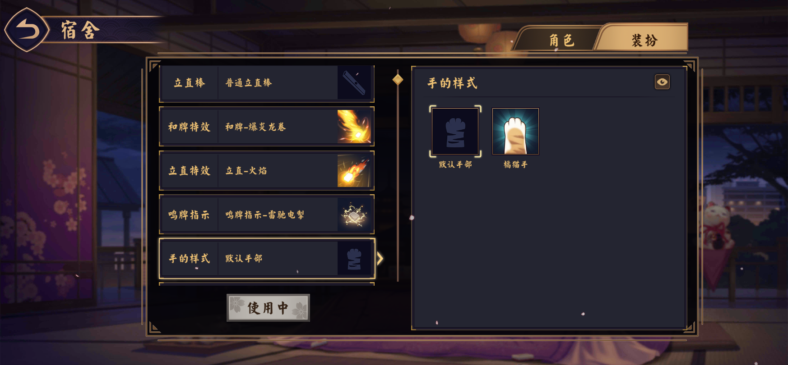
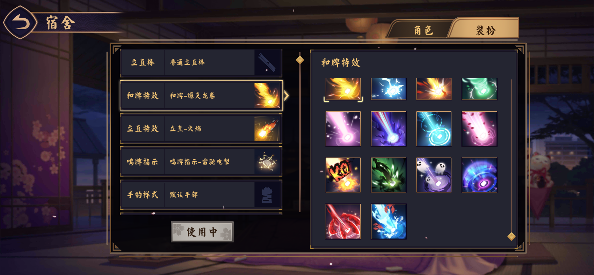
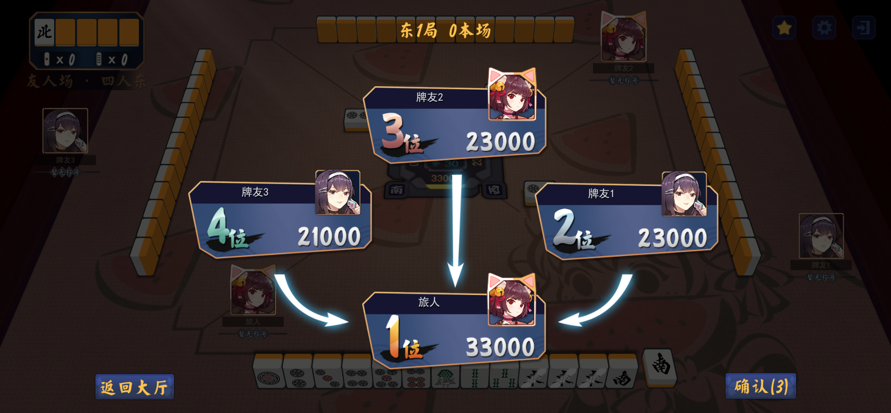
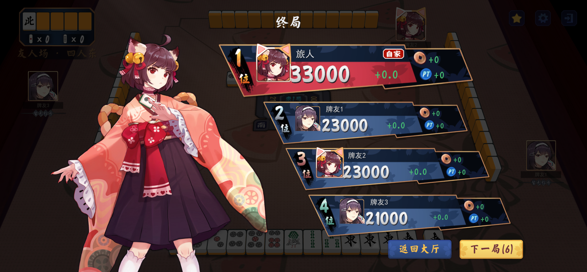
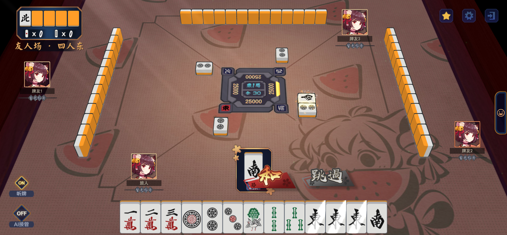
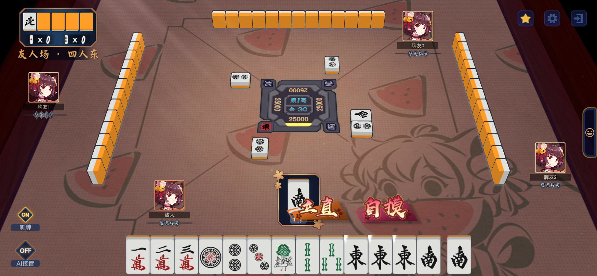

# 装扮与结算修正 R15 · 2026-10-28

本轮交付实际 Unity 运行截图，不生成视频或 APK。当前手机上的 0.6.15 不包含本轮源代码修正。

## 修改结果

- 手部选择只保留“默认手部”和“橘猫手”，删除角色性别和当前角色解释；默认手仍随角色性别解析。
- 装扮右侧图标列表在框内裁切并支持手指拖动、滚轮与滑块滚动。
- 点数结算、终局排名按每位玩家的本局装扮绘制头像框；默认框与猫耳框混合使用，已核对三人和四人界面。
- 对照用户的“我们的软件在有胡牌按钮的时候点击听牌指示会自动关闭.mp4”，修正反应阶段轮询清空听牌开关的问题。同一次荣和／自摸决策中，展开、收起和未结束的点击均可跨轮询保留；局面变更、结果页和失去焦点会清除提示。
- 切后台后先等待 120 秒再离线托管；12 秒的在线状态检查不再触发提前接管，后台通知也不再被客户端 Busy 状态丢弃。

Unity 定向检查 58 项通过；后台托管与游戏规则等 Node 检查 181 项通过。引擎源文件与 Android 插件副本 SHA-256 一致。此处未宣称新 APK 或手机安装验证通过。

## 官方公开配置数量

统计日期为 2026-10-28；来自当日核验的官方公开配置 `0.11.252.w`，统计 item_definition/item 的 category=5。以下为定义记录，包含默认、历史、角色专属和可能不可获得的条目，不等于当前寻觅池或商店可购数量；未另行加上未装备占位项。

| 类别 | 配置条数 |
|---|---:|
| 立直棒 | 61 |
| 和牌特效 | 60 |
| 立直特效 | 57 |
| 手部配置 | 27 |
| 立直音乐 | 17 |
| 头像框 | 90 |
| 桌布 | 69 |
| 牌背 | 57 |
| 大厅背景 | 20 |
| 大厅／对局背景音乐 | 22 |
| 鸣牌指示 | 3 |
| 牌面 | 3 |

合计 **486 条**。其中手部 27 条有 22 条名称标记“已过期”，含男性／女性默认、角色和联动手等内部配置；另外 5 条名称为橘猫爪、夜月猫爪、蓝猫爪、橘色虎爪、立直型强袭猫爪。不能据此理解为界面应列出 27 种普通手部。本项目仍只保留本轮要求的两项。

背景音乐 22 条中，大厅 9 条、对局 13 条；立直音乐 17 条单列。原生资源清单 4.0.51／0.16.289 另有尚未与公开配置映射的条目，因此不把目录数直接当作正式装扮数，也不把本表称为当前原生客户端的完整可获取清单。完整逐条 ID、名称、分类和证据哈希见 decoration-audit.json。

## 全部内置的 APK 大小估算

预计最终 APK 总大小约 **650 MB～1 GB**，以当前资源导入方式估算，尚未全量导入或构建。

- 当前 0.6.15：215,000,953 字节，约 215.0 MB／205.04 MiB。
- 相关原生视觉资源去重后约 197.61 MiB；简体中文与公共资源保留，其他语言重复变体去除。包括棒、和牌／立直／鸣牌特效、手、框、桌布、牌背、牌面、大厅背景与背景特效；这部分包含清单中的较新资源，不仅是上述 486 条记录。
- 17 段立直音乐约 21.11 MiB；22 段大厅／对局背景音乐约 34.18 MiB，仅通过 HEAD 查询体积，未批量下载音频。
- 已完成的 24 种特效样本，原始相关包 6.72 MiB，对应 APK 内资源 12.95 MiB，约 1.93 倍。用该样本外推、扣除已内置特效后，校准值约 658 MB。
- Android 纹理压缩、图集中的其余头像框、共享依赖和手部逐帧网格烘焙均会改变结果，因此采用 650 MB～1 GB 的区间；650 MB 并非实测全量构建值。没有把 DXT 下载包体积直接当成 APK 体积。

该估算不包含额外全角色立绘、皮肤、语音、表情和全部加载 CG。若也要全部内置，需另算。

官方证据：[版本入口](https://game.maj-soul.com/1/version.json)、[公开配置](https://game.maj-soul.com/1/v0.11.252.w/res/config/lqc.lqbin)、[原生资源清单](https://game.maj-soul.com/assetbundles/DXT/bundle_info_so.majset)。

## 截图

