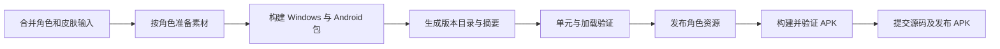

# 新增角色、皮肤与角色资源发布指南

适用工程：云间日麻 Unity；客户端从 **0.6.7 / versionCode 55** 起使用本流程。

本次资源快照为 122 名角色、486 套服饰、69 套动态服饰。目录以项目保存的输入快照为准，不代表未来雀魂版本的完整名单。一姬 `yiji`、二阶堂美树 `erjietang` 始终内置且不可删除；其他角色作为独立资源包下载。默认“部分下载”集合仍为女性 TOP10＋汪次郎，见 `docs/character-resource-inputs/recommended.json`。

## 一、先了解更新边界

- **新增角色或皮肤需要发布新 APK。** 当前目录和服务端角色／皮肤白名单随客户端打包，没有实现远程发现全新目录的热更新。只把文件传到 GitHub，旧 APK 不会自动出现新角色。
- 图片、骨骼、语音和表情可以走独立包；新着色器、骨骼格式、渲染逻辑和协议变化仍需要更新客户端代码。
- 角色 key、角色 ID、已发布皮肤 ID 不改名、不复用、不删除。新增皮肤沿用原角色 key，追加上游皮肤 ID。
- **已公开的 bundle 文件保持不变。** 变更某角色后增加该角色的包版本，使用新文件名和新下载地址；不要覆盖旧 Release 的同名附件。旧 APK、旧资源地址与回退版本继续保留。
- Android 包与 Windows 编辑器包不能混用。两者内容对应、哈希不同，必须分别构建和核验。



## 二、文件分工

| 位置 | 用途 |
| --- | --- |
| `docs/character-resource-inputs/config.json` | 上游角色／皮肤记录的完整输入快照 |
| `docs/character-resource-inputs/versions.json` | 固定版本资源键到 `prefix` 的映射 |
| `docs/character-resource-inputs/framing-default.json` | 原始场景构图基准 |
| `docs/character-resource-inputs/recommended.json` | “部分下载”的角色 key 集合 |
| `unity/Assets/CharacterPacks/Source/<key>/` | 可选角色的本地原始素材；不放进 `Resources` |
| `unity/Assets/Resources/Majsoul/Characters/` | 两个基础角色及共享界面、字体、构图数据 |
| `unity/Assets/Resources/Majsoul/CharacterDirectory/catalog.json` | 客户端角色、服饰、档案、动态分层和表情目录 |
| 同目录 `Avatars/<角色ID>.png` | 未下载角色也能显示的轻量头像，最长边 160px |
| 同目录 `packs-android.json` / `packs-windows.json` | 实际下载版本、大小、SHA-256 和固定 URL |
| 同目录 `build-plan.json` | 本批需要重建的角色与版本；保留其他包的旧地址 |
| `app/src/main/assets/engine.js` | 房间接受的角色／皮肤白名单，必须同步 |
| `unity/Assets/Editor/ProjectSetup.cs` | 唯一客户端版本号及 versionCode 来源 |

大型原始素材可由输入快照再次下载／提取，不必把全量 PNG、MP3 和中间产物重复塞进 Git 历史。工程保留原先已纳入 Git 的参考角色素材；新增角色的交付物以版本化 bundle 为准。源码、输入快照、轻量头像、运行目录和维护工具都要提交。

## 三、准备工具与输入

在项目根目录运行命令。使用项目当前已验证的 Unity **6000.6.4f1**、Python **3.12.14**、Pillow **12.3.0**、UnityPy **1.25.4** 和可运行现有 Node 测试的 Node 环境。使用其他版本前先做完整验证，不要直接把新 Unity 构建的包交给旧播放器。

```powershell
$taskRepo = 'D:\MyWorkSpace\YunJianRiichi_Codex'
Set-Location -LiteralPath $taskRepo
$taskPython = 'python'
$taskNode = 'node'
$taskUnity = 'D:\Unity\Lib\6000.6.4f1\Editor\Unity.exe'
```

当前机器也可以使用 Codex 自带的 Python／Node 可执行文件；不要求在系统里重复安装。读取原 APK 时需要 UnityPy 及本地 APK 索引；使用 `--web-only` 时可跳过 APK，按保存的官方固定版本键下载素材。

同一个角色不要混用 APK 导出缓存与 Web 动态图集缓存；它们的 atlas 页面可能不同。已经通过 APK 提取的本地角色继续用相同来源准备；切换到 `--web-only` 时使用干净的角色缓存，或追加 `--force` 重新准备整名角色。

更新上游数据时，将新增或变更的**完整原始记录**放到 `incoming/character-patch.json`，结构与 `config.json` 一致；包含 `item_definition/character`、`item_definition/skin` 两个数组中的必要记录。只新增皮肤时，可以只提供皮肤数组。资源键与 `prefix` 放到 `incoming/versions-patch.json` 的 `res` 对象内。

```powershell
& $taskPython scripts/merge-character-inputs.py --patch incoming/character-patch.json --versions incoming/versions-patch.json --dry-run
& $taskPython scripts/merge-character-inputs.py --patch incoming/character-patch.json --versions incoming/versions-patch.json
```

合并工具保留原有记录，拒绝重复 ID、角色 key 改名、旧皮肤转移归属和错误的默认／契约皮肤引用。不要拿一份删掉旧联动角色的新数据直接覆盖完整快照。

### 新角色需要核对的字段

角色记录至少核对 `id`、`sound_folder`、`name_chs`、`init_skin`、`full_fetter_skin`、`emo`。`sound_folder` 就是稳定 key，只用小写字母、数字、下划线、连字符。档案还使用 `desc_cv_chs`、`desc_stature_chs`、`desc_birth_chs`、`desc_age_chs`、`desc_bloodtype_chs`、`desc_hobby_chs`、`desc_chs`，保持原始记录字段完整。

皮肤记录核对 `id`、`character_id`、`path`、`name_chs`、`desc_chs`、`spine_type`、`illust_data`、`lobby_offset`、`liaoshe_offset`。原路径里的 `charactor` 是上游拼写，**不要擅自改成 `character`**。

构图还依赖 `full_x/y/width/height`、`smallhead_x/y/width`、`direction`、`no_reverse`、`lock_reverse`。动态还依赖 `spine_width/height`、`pivot_x/y`。这些值应来自相同版本的上游数据，不凭感觉猜坐标。

## 四、已有角色新增皮肤

以下以 `zeniya` 为操作示例；先合并实际新增记录，再运行。新增角色也使用相同步骤，把 key 换成新角色的 `sound_folder`。

```powershell
$taskRole = 'zeniya'
$taskContentRoot = 'build/content-next'
$taskContentTag = 'character-resources-v3'
& $taskPython scripts/prepare-character-resources.py --roles $taskRole --web-only --config docs/character-resource-inputs/config.json --versions docs/character-resource-inputs/versions.json --build-root $taskContentRoot --content-tag $taskContentTag
```

一次可用 `--roles key_a,key_b` 更新多名角色；要准备当前目录全部角色，使用 `--all`。已经公开且皮肤 ID 集合未变的角色会复用原包；新增皮肤的角色自动增加包版本。只有档案文字更改时无需重复构建相同媒体。

**同一皮肤 ID 的图片、骨骼或语音发生修正时，追加 `--force`。** 否则同 ID 的已准备素材会被复用。强制重建也增加包版本，不覆盖已发布文件。

两名基础角色有新皮肤时，原始媒体仍写入 `Resources`，必须重新构建 APK；不能把它们迁成可删除包。

### 素材完整性

每套服饰必须有 `full.png`、`bighead.png`、`smallhead.png`；其他原始展示图有则保留。不要裁掉全图的透明留白，否则同一套构图数据会失效，静态／动态切换也可能跳位置。

动态服饰必须包含实际骨骼、atlas 及 atlas 引用的所有 PNG。当前运行时支持 **Spine 4.2**，准备阶段会检查版本。两到三层骨骼要保留全部分层，不能只下载其中一层；工具会生成 `Spine/<皮肤ID>/<分层>/` 及对应 `parts`。

语音保存为 `Voice/<key>/...`，表情为 `Emoji/<key>/<数字>.png`。上游有通用 `extendRes/emo/` 和较新角色使用的 `lang/base/extendRes/emo/` 两套目录，准备工具依次查找；输入版本映射要保留两套键。只枚举直接子级的数字 PNG，不把 CH／EN／JP 等语言子目录重复映射到同一个输出文件。客户端表情引用必须唯一，并与包内地址逐项对应。角色包包含完整服饰与语音表情，不只上传新皮肤的一张大图。

## 五、构建两平台资源包

生成的计划已经写入客户端 `build-plan.json`，构建入口只构建本批 `build=true` 的角色，保留其他角色的版本。

```powershell
foreach ($taskPlatform in @('windows','android')) {
    $taskTarget = if ($taskPlatform -eq 'android') { 'Android' } else { 'StandaloneWindows64' }
    $taskBuildArgs = @('-batchmode','-nographics','-quit','-projectPath',"$taskRepo/unity",'-buildTarget',$taskTarget,'-executeMethod','YunJian.Riichi.Editor.BuildCharacterPacks.Run','-plannedCharacterPacks','-logFile',"$taskRepo/$taskContentRoot/build-$taskPlatform.log")
    if ($taskPlatform -eq 'android') { $taskBuildArgs += '-packAndroid' }
    $taskProcess = Start-Process -FilePath $taskUnity -ArgumentList $taskBuildArgs -WindowStyle Hidden -PassThru
    $taskProcess.WaitForExit()
    if ($taskProcess.ExitCode -ne 0) { throw "角色包构建失败：$taskPlatform" }
}
& $taskPython scripts/character-packs.py finalize --build-root $taskContentRoot
& $taskNode scripts/sync-character-registry.cjs
```

文件名规则为 `<key>-v<角色包版本>-<platform>.bundle`。目录里的 `version` 是角色包版本，不是 APK 的 versionCode；`bytes` 与 SHA-256 必须来自最终文件，不手工估算。新包使用 LZ4 分块压缩；旧 LZMA 包继续兼容。Unity 说明了两者的加载／内存差异，见[官方压缩与缓存说明](https://docs.unity.com/zh-cn/engine/6000.0/manual/working-in-unity/assets-and-media/asset-workflow/asset-bundles-intro/cache)。客户端校验后释放临时资源，按需加载并限制缓存；不要把全部角色长期常驻内存。

## 六、验证后再发布

先在 `ProjectSetup.cs` 调整 `ReleaseVersion` 和单调递增的 `ReleaseCode`，原包名、签名证书保留。后续构建与校验脚本会读取这两个值。

```powershell
& $taskPython scripts/release-project.py begin --content-root $taskContentRoot
# 输出会给出本次 build/release-xxx 目录；以下以 0.6.8 对应 release-068 为例。
$taskReleaseRoot = 'build/release-068'
& $taskNode --test --test-isolation=none tests/*.test.cjs *> "$taskReleaseRoot/node-tests.log"
& $taskPython -m unittest discover -s tests -p test_character_inputs.py *> "$taskReleaseRoot/input-unit-tests.log"
& $taskNode scripts/sync-character-registry.cjs --check *> "$taskReleaseRoot/registry-check.log"
& $taskPython scripts/verify-character-packs.py --build-root $taskContentRoot
& scripts/verify-unity.ps1 -Mode Validate -EditorPath $taskUnity
```

还要运行 `YunJian.Riichi.Editor.CharacterResourceValidation.Run`，日志记录在本次内容目录，读取报告 `build/character-resources-all/validation/checks.json`。此入口检查全部已开放角色；只检查本次角色可加 `-validatePackKeys $taskRole`，但正式全量发布仍需检查完整目录。原始骨骼必须实际加载和渲染，不能只验证文件存在。

新克隆的工程没有本地 Windows 验证包时，**主动**恢复所需缓存：

```powershell
& $taskPython scripts/fetch-character-pack-cache.py --roles $taskRole --platform windows
# 新克隆工程要做完整目录的正式加载／HTTP回归时，需要所有未重建角色的本地验证包。
& $taskPython scripts/fetch-character-pack-cache.py --roles all --platform windows
```

它不是发布后的重复下载校验步骤。正式发布后用 GitHub 附件大小／摘要和远端提交核对，不反复回下载 APK、ZIP 或角色包。

正式回归还应运行 `scripts/run-character-resource-flow.ps1 -ContentRoot $taskContentRoot`，覆盖下载／校验／取消／续传／损坏拒绝、基础角色保护、删除清理、局域网中转与开局等待。运行 `YunJian.Riichi.Editor.ResourceUiLayoutReview.Run` 生成资源列表、描边清除及四行布局的实际截图，日志写入 `build/resource-ui-r3/review.log`。两项是 `release-project.py assemble` 的必需证据。之后运行 `python scripts/package-full-resource-review.py` 汇总实际截图到当前版本预览目录。单机模拟不能代替多手机热点、后台下载、触摸和低内存真机检查。

上传量较大时可以先执行 `character-packs.py stage --build-root $taskContentRoot`，把文件上传到草稿 Release 并核对附件摘要；完成验证后再执行 `publish` 公开。`stage` 不覆盖已公开附件，也不会自行公开草稿。

```powershell
& $taskPython scripts/character-packs.py publish --build-root $taskContentRoot
& scripts/verify-unity.ps1 -Mode Android -EditorPath $taskUnity
& $taskPython scripts/verify-unity-apk.py *> "$taskReleaseRoot/apk-verify.log"
& $taskPython scripts/release-project.py assemble --content-root $taskContentRoot
& $taskPython scripts/release-project.py curate --content-root $taskContentRoot
# 必须在独立发布目录再测试实际将提交的代码。
Push-Location .publish/YunJianRiiChi
& $taskNode --test --test-isolation=none tests/*.test.cjs *> "$taskRepo/$taskReleaseRoot/publish-node-tests.log"
Pop-Location
& $taskPython scripts/release-project.py commit --content-root $taskContentRoot
& $taskPython scripts/release-project.py publish --content-root $taskContentRoot
```

上述发布入口使用已经保存的 GitHub 登录，不在脚本、APK 或文档里放 token。发布目录只复制明确的源码、配置、文档和实际预览；不纳入 `Library`、工具、原始参考 APK、密钥和玩家运行状态。APK 交付前检查 v1/v2、API23 独立 v1、原证书、16KB 对齐、ZIP 完整性；发布 ZIP 中的 APK 再核对大小和 SHA-256。

## 七、遇到问题时

| 现象 | 处理 |
| --- | --- |
| 宿舍没有新角色 | 检查角色输入、`catalog.json`、轻量头像及新的 APK；只上传附件不会更新旧目录 |
| 有角色但无法下载 | 检查 `available`、两平台目录、Release 是否已公开、固定 URL、大小及 SHA-256 |
| 下载后缺图／动态报错 | 检查所有 atlas 页面、分层、Spine 4.2 版本和原始透明画布；重新跑实际渲染 |
| 新皮肤不在切换／随机列表 | 检查角色资源是否已安装、皮肤 ID、房间引擎白名单及客户端目录是否同步 |
| 旧包能用，新包版本需要重新下载 | 新版本以新 SHA 文件名安装；旧客户端继续使用原地址。单个角色删除会清理该目录的旧版本缓存。不要伪造或手工复制 `.ok` 收据 |
| 出现同名附件／哈希冲突 | 已公开包不能覆盖；增加角色包版本和内容 tag。草稿上传可由工具安全重试 |
| 下载中断 | 保留 `.part`，重试使用范围请求；校验不通过的文件不能启用 |
| 手机空间不足 | 从资源设置删除可选角色；两个基础角色始终保留；先按需要下载单个角色 |

发布检查通过后，在 PR／提交说明中记录：角色 key、角色 ID、新皮肤 ID、角色包版本、内容 tag、APK 版本、包大小／摘要、测试结果，以及未做的真机项目。素材出处和第三方运行时许可证继续保留，见 `ARTWORK.md` 与 `unity/Assets/ThirdParty/Spine42`。
